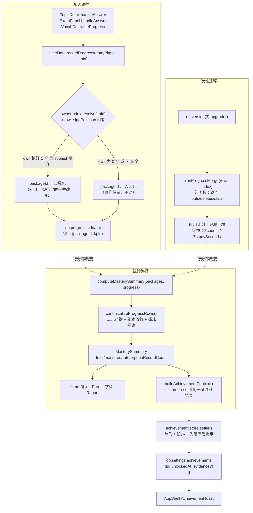
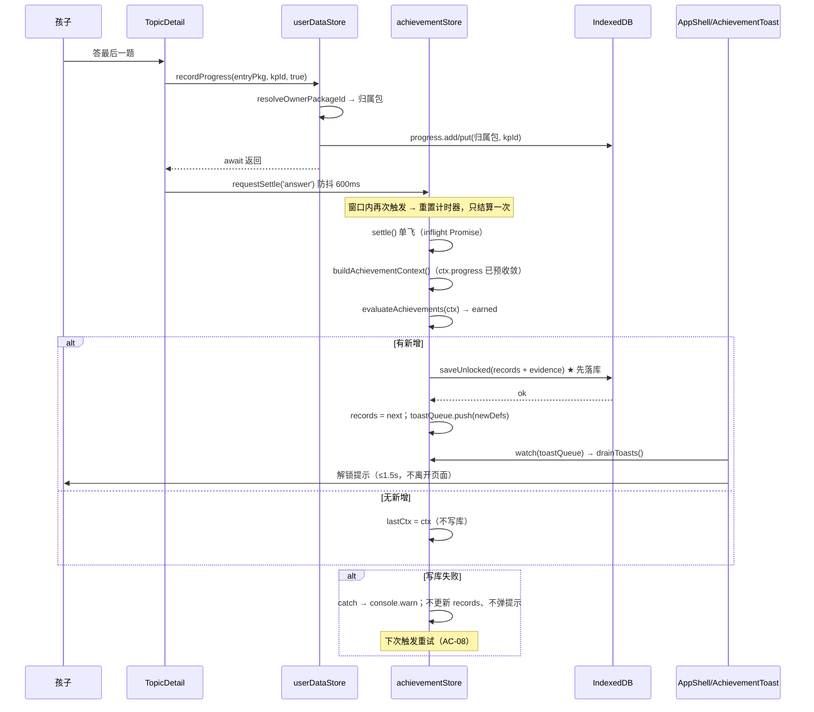
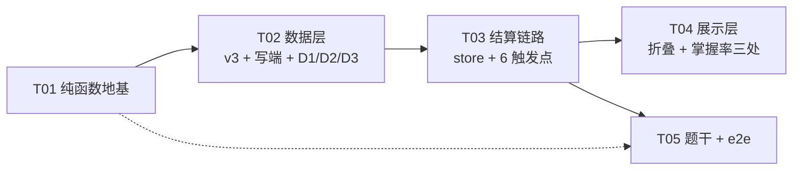

# 家庭学习系统 · 增量系统设计 V1.3

> 角色：架构师 高见远 ｜ 输入：`docs/prd-v1.3-achievement.md`（644 行）、`docs/mastery-metric-definition.md`（255 行）、`docs/kp-id-ownership-english-7.md`（151 行）、`README.md:841-852`
> 性质：**只写设计，不改任何 `src/` 代码**。本文是工程师实现的唯一依据。
> 当前版本：`package.json` → `1.9.1`（V1.2 批6 之后）。本轮建议 `1.10.0`。
> **状态：已完成（§0–§11）。** 读完 §0 再读 §1，§0 覆盖了 6 处会让人踩坑的口径更正。

---

## 0. 与 PRD 的口径对齐表（**先读，6 处更正**）

本轮设计建立在 team-lead 最新裁决之上。裁决与 PRD 原文有 6 处差异，**以本表为准**，工程师不要回 PRD 找旧口径：

| # | 项 | PRD 原文 | 最终口径（本文执行） | 为什么改 |
|---|---|---|---|---|
| **C1** | 「归属包」的 `own` 定义 | §2.3 / §7.1：kpId 唯一归属到"**自己的 `units` 里真的定义了该 kpId**"的包 | 改为「**该包的 `knowledgePoints` 数组里声明了该 kpId**」 | units 口径全库只有 **49.7%**（446/898）能唯一解析（term/sprint/special/daily 的 units 是聚合视图，同一 kpId 有 3–5 个候选）；`knowledgePoints` 声明口径 **100%**（898/898）。且代码里已有同语义实现 `TopicDetail.vue:399-407` |
| **C2** | 歧义分支（`\|own\| >= 2`） | PRD 只说"歧义即保留"，未细化 | **严格三分支，不引入任何 tie-break**：`==0 → null`、`>=2 → null`、`==1 → 该包`；**不按 `packageType` 挑、不按 `title` 挑** | 上一版曾拟"title 全同则取副本代表"，**该拟法在写入层作废**（见 C3）。写入端错了会永久污染数据，宁可不归一化 |
| **C3** | english-7 的「49 个知识点共用 7 个 id」 | §2.3 当作全局事实，并据此否掉 kpId 全局去重 | **运行时（zip 导入）不存在该问题**：43 个包 / 472 个 kpId，每个只被 1 个包声明，零重复、零跨学科冲突；id 构建时已带包前缀（`unit-english-7-up-rjb-p1::kp-reading-001`）。49→7 只存在于**裸 JSON 单文件导入**这条调试路径 | `docs/kp-id-ownership-english-7.md` §0/§1/§2 的实测。结论不变（仍不能用裸 kpId 做键），但**歧义分支的触发概率从"普遍"降为"仅裸 JSON 路径"** |
| **C4** | 成就触发点数量 | §6.1 列 **7 个**（含"#5 `Review.vue` 每次提交后"） | **实际只有 6 个**：`Review.vue` 是**只读列表 + 跳转**（`Review.vue:175 goToTopic`），**没有任何提交动作**；复习作答发生在跳转后的 `TopicDetail`，已被触发器 #2 覆盖 | 源码核实。工程师**不要**去 `Review.vue` 找提交钩子（不存在） |
| **C5** | 掌握率分母 | §4.5：`totalKp` = 全部包 `kpCount` 之和 | `total` = **按 `(packageId, kpId)` 去重**后、再对「同 kpId 且 title 全同」的副本收敛得到的全集大小（`computeMasterySummary` 内部完成） | `mastery-metric-definition.md` §3/§4 + 裁决 4。`Σ kpCount` 与实际 KP 数组长度在聚合包上不等价 |
| **C6** | 合并时 `status` 的取值 | AC-E1-5：「`status` 取**最高等级**（已掌握 > 需复习 > 学习中 > 未学）」 | 改为「**取 `lastStudiedAt` 最新那条的值**，禁止求 max、禁止求和」（`correctStreak` / `wrongStreak` 同规则） | 裁决 3。`status` 是状态机的产物，取 max 会把一条 3 个月前的"已掌握"永久锁死，掩盖当前退步；`latest` 才是状态机语义。**这条与 PRD 直接冲突，按本文执行** |

另有两处**语义澄清**（不是分歧，是 PRD 没写清）：

- **统计层宽松、写入层严格**：`computeMasterySummary` 内部允许"同 kpId 且 title 全同 → 合并计 1"（因为统计不能因为历史脏数据给出错数）；`resolveOwnerPackageId` **绝不**做这个合并（因为写错了会永久污染）。两者是**不同层**的规则，不要互相套用。
- **`achievements.ts` 冻结的边界**：`id / title / desc / check` 冻结（`git diff 99886fe -- src/core/motivation/achievements.ts` 定义行必须为空）；**`UnlockedRecord` 允许新增可选字段 `evidence?: string`**（PRD §4.1 迁移说明 2 已授权），这是本文件唯一允许的改动行。

---

## 1. 实现方案总览

### 1.1 四条轨道与它们的耦合关系

```
轨道 A · 成就 P0（可算进度 / 可折叠 / 全链路结算）      ← 用户价值
轨道 B · E-01 进度归一化（归属包 + v3 迁移 + D1/D2/D3）  ← 数据正确性
轨道 C · E-02 题干最小富文本（换行 + GFM 表格）          ← 可做题
轨道 D · E-03 学习流程 e2e                                ← 回归网
```

**耦合点只有两处**，其余互相独立：

1. **A ← B**：成就的 `masteredKp` / `masteryRate` / `distinctPackages` / `distinctTerms` / 学科覆盖，全部依赖 progress 的行分布。B 改行分布 → A 的数字会变。这不是"顺带影响"，是**必须先定口径再写 A**。
2. **B ← D**：没有 e2e，"归一化后复习计划对不对"只能手测（`Review.vue` 的行是否还在）。D 是 B 的验收工具，不是可选装饰。

C 与 A/B 无耦合，可独立并行（唯一交集是 `ExamPanel.vue` 文件级冲突，见 §6 冲突标注）。

### 1.2 核心数据流



**这张图最关键的一条**：`ctx.progress` 与 `computeMasterySummary` 的输入是**同一份收敛结果**（`canonicalizeProgressRows`）。这直接满足 AC-E1-3（成就分子与掌握率分子同源），且**不需要改动 `achievements.ts` 的任何一行**——`masteredKpCount(ctx.progress)` 天然等于 `summary.mastered`。

### 1.3 关键设计决策（附"为什么不选另一条"）

| # | 决策 | 备选与否决理由 |
|---|---|---|
| **D1** | 归属包解析 = **纯函数 + 内存索引**（`Map<kpId, pkgId[]>`），启动/包加载后建一次，调用点 O(1) | ❌ 每次查 `db.packages.get()`：`findUnitByKnowledgePoint` 现状就是每依赖一次 DB 读，term 包 2-KP 一题要 12 次 IndexedDB 读 |
| **D2** | 归一化写在 **`recordProgress` 内部**（单一收口），不逐个改 4 个调用点 | ❌ 改 4 个调用点：任何新调用方都会忘；`ExamPanel` 的 `deps[0]` 正是"调用方自己猜包"的产物。收口后 D1 缺陷**结构性消失** |
| **D3** | 迁移逻辑 = **纯函数 `planProgressMerge(rows, index)`** + Dexie 钩子只做 apply | ❌ 逻辑直接写在 `upgrade()` 里：`tests/user-data-store.test.ts` 用的是**假 Dexie**（`:50-65` 只识别一个索引名），钩子里的代码在 node 环境根本跑不到；纯函数才可测守恒与幂等 |
| **D4** | 统计层 `computeMasterySummary` 做**两层收敛**（二元组 + 同 title 副本） | ❌ 只做二元组：base+unit 重复登记的历史数据会让分母偏大；❌ 只做裸 kpId：english-7 raw 路径 49→7 灾难 |
| **D5** | 成就上下文 **预收敛**（`ctx.progress` 传收敛后的行） | ❌ 改 `masteredKpCount` 去调 `computeMasterySummary`：违反 AC-01 冻结。预收敛让两条路径**结构上**同源，无需改冻结文件 |
| **D6** | 结算 **单飞 Promise + 600ms 防抖 + 先落库后提示** | ❌ 每次触发都直接 `syncAchievements`：一次作答触达 2 个 KP → 2 次并发结算 → 同一枚徽章弹两次（`syncAchievements` 读写不是原子） |
| **D7** | 题干富文本 = **自写最小子集纯函数**，不引入 `markdown-it` 渲染题干 | ⚠️ `markdown-it` 已是依赖（`package.json:34`），但整库渲染会带来：`linkify` 生成 `<a>`、`breaks` 改变 1954 道题的空白语义、表格样式需全局 CSS。最小子集**先转义再解析**，注入面可控 |
| **D8** | 折叠状态存 `db.settings['achievementUi']`，存**收敛后的显式列表**而非差异 | ❌ 存"是否展开"布尔：默认态变化后历史值语义漂移；显式列表 + 读失败静默降级为默认态最稳 |
| **D9** | 迁移失败**只告警、不阻塞启动**，且统计层自愈 | 因为 `computeMasterySummary` 按 key 去重（`progressByKey` 取 `lastStudiedAt` 最新），**即使一行没合并，掌握率仍然 ≤100%**。迁移只解决"存储卫生 + 复习计划正确"，不是正确性前提 |
| **D10** | 迁移保留 **`id` 最小的那条**作为合并承载体 | ❌ 保留 `lastStudiedAt` 最新的：`id` 是稳定可复现的，`lastStudiedAt` 相同（同一天两次作答）时无法定序 → 幂等测试会 flaky |

---

## 2. E-01：`progress.packageId` 归一化为归属包

### 2.1 归属包的定义与索引（`src/core/progress/ownerIndex.ts`，新增）

**`own` = 该包的 `knowledgePoints` 数组里声明了这个 kpId 的包。**不是 units 里引用它的包（C1）。

```ts
export interface OwnerIndex {
  /** kpId（原值） → 声明了它的 packageId 列表 */
  byKpId: Map<string, string[]>
  /** 短 id（去 `::` 前缀） → 声明了它的 packageId 列表。仅用于兜底，绝不单独用于写入决策 */
  byShortKpId: Map<string, string[]>
  /** packageId → subject，用于 subject 相容性闸门 */
  subjectByPkgId: Map<string, string>
}

export function buildOwnerIndex(packages: LearningPackageRecord[]): OwnerIndex

/**
 * 解析归属包。三分支，无 tie-break。
 * @param kpId 进度里要用的 kpId（原值）
 * @param entryPackageId 学习入口包（调用方传进来的是什么就是什么）
 * @returns 归属 packageId，或 null（不归一化，保留原记录）
 */
export function resolveOwnerPackageId(
  kpId: string,
  entryPackageId: string,
  index: OwnerIndex,
): string | null
```

**算法（严格顺序，命中即返回）**：

```
1. exact = index.byKpId.get(kpId) ?? []
   |exact| == 1  → owner = exact[0]
   |exact| >= 2  → return null            ← 歧义：不猜
   |exact| == 0  → 落 2

2. short = index.byShortKpId.get(stripPrefix(kpId)) ?? []
   |short| >= 2  → return null            ← 裸 JSON 路径的 english-7 就死在这里，正确
   |short| == 0  → return null
   |short| == 1  → owner = short[0]       ← 历史行写的是短 id，但全库只有一个声明者

3. 闸门：index.subjectByPkgId.get(owner) !== index.subjectByPkgId.get(entryPackageId) → return null
   （跨学科归属一律视为异常，不动。运行时数据里不应触发；触发即说明内容包有问题）

4. return owner
```

**为什么第 3 步要保留**：`special-chinese-4-up-reading`（语文）与 english-7（英语）共用短 id `kp-reading-001`。第 2 步会因 `|short| >= 2` 直接返回 null，所以闸门在这条路径上是冗余的——但它保护的是"未来某个包声明了别的学科的同名 kpId"这种新脏数据。**冗余的安全网比事后追数据便宜。**

**索引建在哪里 / 何时建**：

- `packageStore`（`src/core/stores/package.ts`）新增 `ownerIndex: computed(() => buildOwnerIndex(packages.value))`。
- `recordProgress` 与迁移都需要它。迁移在 DB 打开时执行，此时 store 还没初始化 → 因此 `buildOwnerIndex` 必须**接受任意 packages 数组**，迁移自己从 `tx.table('packages')` 读。
- 成本：898 个 kp × 2 次 Map 写入 ≈ 1ms 级，包加载时算一次，**不入 DB、不落缓存**。

**与 `TopicDetail.vue:399-407` 的关系**：那段 `ownerPackageIdOf` 就是同一个语义，但（a）每次调用 O(包×KP) 全扫，（b）找不到时 fallback 到 `currentPackageId`（把"不知道"伪装成"知道"）。**提取为纯函数后删除本地实现**，fallback 改为 `null`（由调用方决定"保留入口包"）。

### 2.2 写入端：归一化收口在 `recordProgress` 内部

```ts
// src/core/stores/userData.ts  （唯一改动点）
async function recordProgress(
  entryPackageId: string,        // ← 语义变更为「入口包」，不再是「最终写入的包」
  knowledgePointId: string,
  isCorrect: boolean,
  opts: RecordProgressOptions = {},
) {
  const index = await ensureOwnerIndex()          // 懒加载，见下
  const owner = resolveOwnerPackageId(knowledgePointId, entryPackageId, index)
  const packageId = owner ?? entryPackageId        // ← 解析失败：原样保留（不猜）
  const kpId = owner ? canonicalKpId(owner, knowledgePointId, index) : knowledgePointId
  // ...其余逻辑完全不变（BKT / FSRS / 状态机 / 计数）
}
```

**`canonicalKpId(owner, kpId, index)`**：若 `kpId` 就在 owner 的声明列表里（exact 命中）→ 返回原值（**99%+ 的情况，零变化**）；若命中的是短 id 分支 → 返回 owner 声明的那个完整 id。见 §9 待裁决 1。

**`ensureOwnerIndex()`**：`packageStore.packages` 为空时（例如冷启动直接进 Review）从 `db.packages.toArray()` 临时建一次，并缓存到模块级变量，包变更（导入/删除）时失效。**不放在热路径**：一次作答 1 次 Map 查询。

**四个调用点全部不需要改逻辑**（这是 D2 决策的收益）：

| 调用点 | 现状传参 | 改后行为 |
|---|---|---|
| `TopicDetail.vue:447`（前置热身） | `ownerPackageIdOf(kpId)` ← 本地实现 | 可传 `currentPackageId.value`，内部解析。**本地 `ownerPackageIdOf` 删除** |
| `TopicDetail.vue:513`（主练习） | `currentPackageId.value` | 不变，内部解析 |
| `ExamPanel.vue:341` | `sourcePackageId.value` = `deps[0]` | **不改传参也不会写错包**（内部解析覆盖）。但 `sourcePackageId` 仍被 `addMistake` 用，见 §2.4 D1 |
| `VocabDrill.vue:273` | `props.packageId` | 词表 word.id 不在任何包的 `knowledgePoints` 里 → `own == 0` → **保留入口包**（见 §9 待裁决 2） |

> ⚠️ **`addMistake` 的 `packageId` 不受本机制保护**。它直接把入口包写进 `db.mistakes`，而 `Mistakes`/`Review` 用 `mistakes.packageId` 做学科标签与包标题。D1 的修复必须显式改这一处传参（§2.4）。

### 2.3 E-01 数据迁移：`version(3)` + 启动补偿（**最终实现，已落地**）

> **最终裁决（2026-10-19，覆盖此前「撤销 `version(3)`」的说法）**：**采用 `version(3)`**。
> `stores` 与 v2 **逐字符相同**（主键仍 `++id`、索引仍 `[packageId+knowledgePointId]`），
> 升版本**只为拿到 `upgrade()` 钩子**；钩子内部**永不 rethrow**。

**为什么最终接受（三次反复后的结论）**

| 曾经的反对理由 | 为什么不成立 |
|---|---|
| 「失败后无法重试 —— 版本号推进了，钩子不再触发」 | 补偿**不靠**钩子二次触发：钩子失败时写 `migration:v3 = {status:'failed'}`，由启动时 `recoverV3IfNeeded()` 用**同一份纯函数**补跑。这是设计里本就有的三态机制，不是我新增的补丁 |
| 「主路径零自动化覆盖（node 环境跑不到 IndexedDB 升级）」 | **可测性由接口保证**：`planV3Migration(tx)` / `applyMergePlan(tx, plan)` 都接收 `tx`，测试塞一个假事务即可直测（`tests/progress-migrate.test.ts` 26 例），与"能不能跑真 upgrade"无关 |
| 「多一个版本号是技术债」 | 收益是**原子性**：v2→v3 在同一个 versionchange 事务里完成 put + delete，中途失败整体回滚，不存在"改了一半"的中间态。手写启动任务要自己保证这一点 |

**两条失败路径（必须分清，别混）**

| 路径 | 触发条件 | 表现 | 兜底 |
|---|---|---|---|
| **A. 事务被 aborted** | 写库失败（配额/IO） | Dexie 把整个 versionchange 事务标记 aborted，**版本号不推进** | 下次 `db.open()` 从头重跑 `upgrade()` |
| **B. 钩子正常返回但计划构建失败** | 老数据形状意外（如字段类型不对） | 版本号**照常推进**，写 `status:'failed'` | 启动时 `recoverV3IfNeeded()` 补跑，**最多 `MAX_ATTEMPTS = 3` 次**，超限不再扫表（反复失败说明形状超出预期，再扫也没意义） |

> 「schema 与 v2 逐字符相同」的意义**不是**"下次自动重试"，而是：
> **迁移彻底失败也只是统计口径暂时不收敛 —— 应用照常可用、数据一行不丢**。

#### 2.3.1 实现了什么

| 文件 | 内容 |
|---|---|
| `src/core/storage/migrateV3.ts` | `planV3Migration(tx)`（只读+纯计算，唯一 try/catch 面）、`applyMergePlan(tx, plan)`（哑 IO：put 先于 delete）、`migrateProgressV3(tx)`（upgrade 钩子，永不 rethrow）、`writeMarker`、`MAX_ATTEMPTS` |
| `src/core/storage/migrateV3Recovery.ts` | `readMigrationMarker`、`shouldRunRecovery`（纯函数，判断是否补跑）、`recoverV3IfNeeded`（启动补偿）、`ensureE1Migrated({ orphanOnly, mode? })`（导入/恢复/启动后重归因）、`awaitE1Settled`（写入端等待信号） |
| `src/core/storage/startupOrphanRecovery.ts` | `runStartupOrphanRecovery()`（启动兜底重归因，**同一本地日期最多一次**，永不抛）、`shouldRunOrphanRecovery(lastDay, today)`（纯函数）、`STARTUP_RECOVERY_KEY = 'progress:lastStartupRecovery'` |
| `src/db/index.ts` | `version(3).stores({...与 v2 逐字符相同}).upgrade(tx => migrateProgressV3(tx))` |
| `src/main.ts` | `router.isReady().then(() => { app.mount('#app'); void recoverV3IfNeeded().then(() => runStartupOrphanRecovery()) })` |

#### 2.3.2 `ensureE1Migrated({ orphanOnly })` —— 与启动补偿**不是**同一件事

| 维度 | `recoverV3IfNeeded()` | `ensureE1Migrated({ orphanOnly: true })` |
|---|---|---|
| 时机 | 应用启动一次 | **每次导入包 / 恢复备份之后**；以及应用启动（同一本地日期最多一次，见 `startupOrphanRecovery.ts`） |
| 语义 | 一次性版本迁移 | 可重复的"按当前包列表重新归因" |
| 写 `migration:v3` | 写（`ok-recovered` / `failed`+attempts） | **绝不写**（否则 `ok` 变谎言） |
| 另记 | — | `settings['progress:lastRecovery'] = { at, stats, mode }`（`mode` ∈ `import` / `restore` / `startup`，仅观察字段） |
| 零计划 | 仍写标记 | **不起写事务**（先只读算计划，为空直接返回） |

两条入口**走同一条串行队列**（module 级 promise 链 `tail` / `serialize()`）：否则启动迁移还没结束、导入补跑并发进来，同一批行会被求两次和 → `correctCount` 翻倍，而**守恒自检照样通过**（它比的是"本次迁移前后"，不是"两次叠加后"）。

> **2026-10 修订（终验后）**：原先用的是「共用一把 `inflight` 锁 + 撞锁就复用对方那个 promise」。
> 问题是两个入口的返回类型不同（`MigrationMarker | null` vs `MergeStats | null`），
> 复用必须写 `(await inflight) as MergeStats` 这种断言 —— 在「启动补偿正在飞、用户正好导入包」时
> 会把 marker 当成 stats 返回（`rewritten` 变 `undefined`），**并且静默跳过自己的重归因**。
> 现改为串行队列：每个调用者拿自己的结果，撞车时后者在前者结束后**按最新库状态重算**
> （真没活可干时计划为空 → 零写事务）。回归测试见 `tests/progress-migrate.test.ts`
> 的「串行队列 — 两个入口同时触发时不许互相串味」，两条用例在旧实现下都会红。

#### 2.3.3 marker：`db.settings['migration:v3']`

```ts
interface MigrationMarker {
  status: 'ok' | 'failed' | 'ok-recovered'
  at: string                  // ISO
  stats?: MergeStats
  error?: string
  attempts?: number           // 只在 failed 语义下有值
}
```

- **名字叫 `migration:v3`**（既然真的升到了 v3，比 `migration:e1` 准确；早期「不升版本」方案里的 `migration:e1` 命名随之作废）。
- **跳过条件** = `status ∈ { ok, ok-recovered }`；`failed` 且 `attempts < 3` 才补跑。
- 三态的意义：区分"首次即成功"（`ok`）与"失败后补跑成功"（`ok-recovered`）—— 两态合一就观察不到恢复路径是否真的走过。

#### 2.3.4 一次性备份：**未实现（诚实标注）**

设计稿曾要求"首次迁移前把 `progress` 全表写入 `settings['progressBackupV2']`"。
**当前实现没有做**，理由与风险一并记在这里：

- 不做的理由：备份会把整表复制进 `settings`（几千行 ≈ 数百 KB～MB 级），而 `settings` 每次读写都是整行；且**导出功能本来就能给出等价的安全网**（`exportUserData` 含 progress 全量）。
- 现实风险：迁移是**有损**的（合并两组 FSRS 卡必丢一张的复习历史）。若没有事先导出，这个损失不可逆。
- **上线动作（必须做）**：发布前提醒用户先在「设置 → 导出备份」导一次。若后续用户反馈"合并后复习计划不对"，再补实现备份（加字段，不改 schema）。

#### 2.3.5 执行计划（纯函数）+ 合并语义

> **现状**：纯函数部分**已交付**（commit `5aa0242`）：`src/core/progress/progressMerge.ts`（293 行，`planProgressMerge` + `mergeProgressGroup`，含 C6 语义、D10 承载体、守恒自检）。**不要重写**。

```ts
// src/core/progress/progressMerge.ts（已存在，纯函数，不 import Dexie）
export interface MergeStats { total: number; rewritten: number; mergedGroups: number
  mergedRowsRemoved: number; ambiguousKept: number; final: number }
export interface MergePlan { puts: ProgressRecord[]; deletes: number[]; stats: MergeStats }
export function planProgressMerge(rows: ProgressRecord[], index: OwnerIndex): MergePlan
```

**算法**（已实现，此处是合同）：

```
1. rows = 全表；packages = 全表；index = buildOwnerIndex(packages)
2. 每行定终键：owner = resolveOwnerPackageId(kpId, row.packageId, index)
   finalPkg = owner ?? row.packageId；finalKp = owner ? canonicalKpId(...) : kpId
   key = `${finalPkg}\u0000${finalKp}`；owner === null → ambiguousKept++
3. 按 key 分组；组内按 id 升序，id 最小者为承载体（keeper）
4. size===1 且键未变 → 零写入；size===1 但键变了 → put，rewritten++
   size>=2 → put(合并后)，deletes += 其余 id，mergedGroups++
5. 守恒自检失败 → puts/deletes 清空（宁可不动）
```

**合并语义表（逐字段，无歧义）**：

| 字段 | 规则 | 依据 |
|---|---|---|
| `correctCount` / `wrongCount` / `studySeconds` | **求和** | 裁决 3 |
| `lastStudiedAt` | **取最大** | 裁决 3 |
| `status` / `correctStreak` / `wrongStreak` | **取 `lastStudiedAt` 最新那条的值**（禁止求和、禁止取 max 等级） | 裁决 3 / **C6** |
| `bkt.observed` | **求和**（累计观测次数可累加） | 裁决 3 |
| `bkt` 其余参数 / `pKnown` / `masteryProbability` | 取 `observed` **最大那条的同源值**（**禁止平均**：0.92 与 0.2 平均出 0.56 会造出"谁都不是"的后验） | 裁决 3。**计数可加，后验概率不可加** |
| `fsrs` | 取 **`last_review` 最新**的卡；全组都无 → 保持 `undefined` | 裁决 3。FSRS 状态不可重放，只能选一张 |
| `reviewStage` / `nextReviewAt` / `lastReviewAt` | **与选定 `fsrs` 同一来源行**（不许跨行拼装） | 跨行拼装会让 `nextReviewAt` 与卡片 `due` 打架 |

> 同 `lastStudiedAt` 的两条 → 用 `id` 升序定序，保证幂等（D10）。

**幂等的验收方式**：`planProgressMerge(rows, index)` 连跑两次，第二次 `puts.length === 0 && deletes.length === 0`。这条**不依赖 DB**，node 里可直接测。

#### 2.3.6 已知有损（写进代码注释与 CHANGELOG，不做事后补救）

- **`fsrs`**：同一 KP 多张卡只保留 `last_review` 最新的一张，**另一张的复习历史永久丢失**（FSRS 无回放日志，无法重建）。
- **`bkt`**：只保留 `observed` 最大那条的轨迹，其余轨迹丢失；`observed` 虽求和，但 `pKnown` 不是"合并后重新推导"的值。
- **不可逆**：迁移后无法从数据本身还原迁移前的行分布（只能靠 §2.3.4 的备份）。

### 2.4 必须同批修复的 D1 / D2 / D3

#### D1 · `ExamPanel.vue:266-269`（`deps[0]` 兜底）

```ts
// 现在
const sourcePackageId = computed(() => props.pkg.manifest.dependencies?.[0] ?? props.pkg.packageId)
// 改后：入口包 = 自己（不再拿 deps[0] 冒充）
const entryPackageId = computed(() => props.pkg.packageId)
```
并在 `handleAnswer` 里，为 `addMistake` 单独解析归属：

```ts
const ownerOf = (kpId: string) => resolveOwnerPackageId(kpId, props.pkg.packageId, ownerIndex) ?? props.pkg.packageId
for (const kpId of kpIds) {
  await userDataStore.recordProgress(entryPackageId.value, kpId, ...)   // 内部解析
  if (!payload.isCorrect) await userDataStore.addMistake(question, ownerOf(kpId), kpIds, ...)
}
```

> `recordProgress` 传入口包即可（内部解析）；`addMistake` 必须显式传归属包，因为它没有收口层。
> **注意**：`addMistake` 现状在 `if (!isCorrect)` 里对**一道题**只调用一次（`kpIds` 整体作为 `knowledgePointIds`）。一道题可能跨 2 个 KP、分属不同包 → 取 `kpIds[0]` 的归属包，与现状一致，不扩大改动面。

#### D2 · `resolvePackageUnits.ts:22-55`（丢自有 units）

```ts
export async function resolvePackageUnits(pkg: LearningPackageRecord): Promise<ResolveUnitsResult> {
  const deps: string[] = pkg.manifest?.dependencies ?? []
  const units: ResolvedUnit[] = []
  const seen = new Set<string>()
  const missing: string[] = []

  // ① 先把自有 units 放进去（顺序在前 = 默认首屏先看到自己的单元）
  for (const u of pkg.units ?? []) {
    if (!u?.id || seen.has(u.id)) continue
    seen.add(u.id)
    units.push({ unit: u, sourcePackageId: pkg.packageId, sourcePackageTitle: pkg.manifest.title })
  }
  // ② 再追加依赖包的 units，按 unit.id 去重
  for (const depId of deps) {
    const dep = await db.packages.get(depId)
    if (!dep) { missing.push(depId); continue }
    for (const u of dep.units ?? []) {
      if (!u?.id || seen.has(u.id)) continue
      seen.add(u.id)
      units.push({ unit: u, sourcePackageId: dep.packageId, sourcePackageTitle: dep.manifest.title })
    }
  }
  return { units, missing, isAggregate: deps.length > 0 }
}
```

**去重键 = `unit.id`**，且实测**全库 114 个自有 unit 零 `unitId` 碰撞**（id 都带包前缀），所以去重只是防御。

**必须一起解决的问题（english-7 链式依赖）**：`p2 deps=[p1]`、`p3 deps=[p2]` … `p7 deps=[p6]`。现状下：
- `UnitList.vue:72-73` 只用 `result.units` → **p2 的单元列表显示的是 p1 的单元**；
- `Review.vue:151` 用 `findUnitByKnowledgePoint(p2, p2 的 kp)` 反查 → p2 的自有 units 被丢弃 → 返回 null → `continue` → **p2~p7 的学习记录全部进不了复习计划（6/7 单元包）**。

修 D2 后两处一起解决：自有 units 在前，`findUnitByKnowledgePoint` 第一轮就命中自有 unit。

> **副作用（要写进 PRD 脚注而不是隐藏）**：`p2` 的单元列表会同时显示 `u2`（自有）与 `u1`（依赖）。这是链式依赖的正确表达，但对孩子是"多了一个单元"。单元列表已有 `sourcePackageTitle` 字段用于标注来源，UI 上必须**显示来源包标题**，否则孩子会以为 p2 里凭空多了一课。

#### D3 · `Review.vue:133-139`（裸 kpId 索引）

```ts
// 键改成二元组，与 progress 口径一致
const kpTitleMap = new Map<string, { title: string; pkgId: string }>()
for (const p of packages) for (const kp of p.knowledgePoints ?? []) {
  kpTitleMap.set(`${p.packageId}\u0000${kp.id}`, { title: kp.title, pkgId: p.packageId })
}
// 兜底：短 id 且在**全库唯一**时才用
const kpTitleByShort = new Map<string, { title: string; pkgId: string }>()
{ const seen = new Map<string, number>()
  for (const p of packages) for (const kp of p.knowledgePoints ?? []) {
    const s = stripPrefix(kp.id); seen.set(s, (seen.get(s) ?? 0) + 1)
    kpTitleByShort.set(s, { title: kp.title, pkgId: p.packageId }) }
  for (const [s, n] of seen) if (n > 1) kpTitleByShort.delete(s)      // 歧义即删，绝不猜
}
// 查找
const info = kpTitleMap.get(`${p.packageId}\u0000${p.knowledgePointId}`)
          ?? kpTitleByShort.get(stripPrefix(p.knowledgePointId))
if (!info) { droppedCount++; continue }        // 仍会丢，但**计数并显示**（见下）
```

**新增可见的降级提示**：`Review.vue` 顶部若 `droppedCount > 0`，显示一行 `有 N 条学习记录无法定位到单元（对应学习包可能已删除或重新导入）`。**不许静默丢**——这是现状最隐蔽的数据丢失。

### 2.5 掌握率三处统一

`computeMasterySummary` 的完整定义见 `docs/mastery-metric-definition.md`（已定稿）。本节只写**落地形状**与三处调用点。

#### 2.5.1 导出的三个东西

```ts
// src/core/mastery/masterySummary.ts（新增）
export interface CanonicalKp { key: string; packageId: string; kpId: string; title?: string }
export interface MasterySummary {
  total: number; mastered: number; learning: number; needReview: number
  unlearned: number; notStarted: number; rate: number; orphanRecordCount: number
}

/** 收敛结果：三处展示都要用它，禁止各自再排一遍 */
export function canonicalizeProgressRows(
  packages: LearningPackageRecord[],
  progress: ProgressRecord[],
): { entries: CanonicalKp[]; rowByKey: Map<string, ProgressRecord>; orphanRows: ProgressRecord[] }

export function computeMasterySummary(
  packages: LearningPackageRecord[],
  progress: ProgressRecord[],
): MasterySummary
```

`canonicalizeProgressRows` 是**唯一的收敛实现**，`computeMasterySummary` 与 `buildAchievementContext` 都调它（D5）。

#### 2.5.2 三处改法

| 文件 | 现状 | 改后 |
|---|---|---|
| `Home.vue:283-292` | 自算 total/mastered/learning/rate | `const s = computeMasterySummary(packageStore.packages, userDataStore.progress)`；返回 `s.total / s.mastered / s.learning / s.rate`。**删除 `Home.vue:414` 的 `Math.max(...,0)`**（`notStarted` 已保证 ≥0） |
| `Parent.vue:183-212 / 215-245` | `stats` 无 rate；`subjectStats` 用裸 kpId 反查学科 | `stats` 用 `computeMasterySummary`；`subjectStats` 改为遍历 `canonicalizeProgressRows(...).entries`，学科取 `packages.find(p=>p.packageId===entry.packageId).manifest.subject`，`mastered` 取 `rowByKey.get(entry.key)?.status === '已掌握'` |
| `reportGenerator.ts:50-160` | `allKpIds` 裸 kpId 去重 + 未去重分子 | 三者全部来自 `computeMasterySummary` + `entries`；`notStarted` 用 `s.notStarted`（不再 `total - progress.length`） |

**禁止清单**（`grep` 验收）：改完后 `src/` 内不得再出现
- `mastered / total`、`mastered/total * 100` 形式的就地表达式（三处都改成读 `summary.rate`）
- `totalKnowledgePoints - progress.length`
- `Set<...>().add(kp.id)` 用于分母的写法

#### 2.5.3 期望的数字变化（给 QA 建基线）

| 位置 | 方向 | 幅度 |
|---|---|---|
| Report 整体掌握率 | **显著下降** | 分母从"裸 kpId 去重"变"二元组全集"，english-7 类包被正确展开（若历史数据是 raw JSON 路径，7→49） |
| Report `notStarted` | 由可负 → **非负** | 改由 `summary.notStarted` 提供 |
| Home 掌握率 | 略降或持平，**不再 >100** | 分子去重 + 孤儿隔离 |
| Home / Parent 「已掌握」计数 | 可能略降 | 去掉重复行；词表行转为孤儿（见 §9 待裁决 2） |
| Parent / Report 学科分布 | 学科间**重新分配**（有升有降） | 学科归属由"裸 id 覆盖"→"归属包 subject" |

> **QA 必须在基线说明里写**："掌握率口径从『裸 kpId 去重 / 记录条数』统一为『(packageId, kpId) 二元组』，故 rate 下降是**预期修正**，不是回归。"

### 2.6 成就受口径变更影响的连带清单（裁决 6 要求逐条写明）

前提：`ctx.progress` 传的是**收敛后**的行（§1.2）。因此所有读 `ctx.progress` 的 `check()` 都看到"一行 = 一个真实知识点"。

| 成就 id | 依赖的统计基元 | 方向 | 说明 |
|---|---|---|---|
| `first-step` / `ten-kp` / `fifty-kp` / `hundred-kp` / `kp-300` | `masteredKp` = 收敛后 `status==='已掌握'` 行数 | **变难** | 同一知识点重复行被合并（原来 3 个入口包 → 3 行 → 现在 1 行）；孤儿行（词表、已删包）不再计入 |
| `mastery-half` | `masteredKp / Σ kpCount` | **变难** | 分子去重；分母口径见 C5（分子用二元组全集更准，`kpCount` 之和在聚合包上偏大 → 实际可能略变易，需 QA 实测） |
| `perfect-kp` / `streak-master` | `max(correctStreak)` | **可能变易** | 重复行被合并后 `correctStreak` 取最新那条而非 max → **变难**；但同一知识点的连续答对现在落在同一行上（不再分裂到 2 行）→ **变易**。**方向不定，QA 必须实测**，不得在文档里断言 |
| `patience` | `max(correctCount + wrongCount)` | **变易** | 同上：原来一道题触达 2 个入口包会把计数分裂到 2 行，合并后集中在 1 行 |
| `subject-master-3` | 按学科分组的已掌握数 | **方向不定** | 学科归属从"裸 id 覆盖（后者胜）"改为"归属包 subject"：被错误覆盖的学科会**补回**，也可能有行从某学科**移出** |
| `explorer-3` / `explorer-10` | `distinctPackageCount` = `Set(progress.packageId).size` | **方向不定** | 归一化后 `packageId` 是**归属包**：从冲刺包（1 个入口）做题 → 原来算 1 个包，现在算 5 个归属单元包 → **变易**；从 3 个聚合包做题但都指向同 5 个单元 → **变难**。**见 §9 待裁决 3** |
| `term-cross` | `studiedTerms`（包 → term） | **多半变易** | 聚合包 `manifest.term` 常为空串，归属的单元包有准确学期 |
| `senior-new` | `studiedSubjects`（包 → subject） | **可能变难** | 若某条非数学行原本挂在数学入口包下，归一化后仍是数学 → 该条证据消失。**已解锁不回收**兜住已拿到的用户 |
| `review-20` / `mistake-*` / `streak-*` / `daily-20` / `early-bird` / `night-owl` / `type-collector` | mistakes / streak / dailyStats / attemptedTypes | **不变** | 不读 `orderBy` 之外的 progress 行分布（`mistakes` 表未被归一化改动） |

**硬不变量（写进测试）**：`已解锁记录集合`在迁移前后**只能超集不能子集**——`syncAchievements` 的合并逻辑（`achievements.ts:474-488`）已经是"只增不减"，本轮**不得**引入任何"回收/降级"路径。QA 断言：迁移前后的 `ids` 满足 `after ⊇ before`。

---

## 3. 成就 P0（轨道 A）

### 3.1 模块划分（4 个新文件，职责不重叠）

| 文件 | 性质 | 职责 | 依赖 |
|---|---|---|---|
| `src/core/motivation/achievementMeta.ts` | 纯静态表 | 28 枚的 `source` / `tier` / `target` / `unit` 派生元数据 + `metaOf(id)` | 无 |
| `src/core/motivation/achievementProgress.ts` | 纯函数 | `progressOf(id, ctx)`、`progressText(p)`、`buildEvidence(def, ctx)` | `achievementMeta` |
| `src/core/motivation/achievementContext.ts` | 有 I/O | `buildAchievementContext()` —— **唯一**的 ctx 组装入口 | stores + `canonicalizeProgressRows` |
| `src/core/stores/achievement.ts` | Pinia | `records` / `settle()` 单飞 / 防抖 / `toastQueue` | 上述三个 + `achievements.ts` |

**为什么不把 `progressOf` 放进 `achievements.ts`**：那个文件冻结（AC-01）。新建文件 + 单向依赖，才能既复用它的 `check` 又不碰它。

### 3.2 `source` / `tier` 派生表（28 枚，静态、不入库）

```ts
export type AchievementSource = 'core' | 'subject' | 'habit' | 'hidden'
export type AchievementTier = 'common' | 'advanced' | 'rare' | 'hidden'
export interface AchievementMeta {
  source: AchievementSource
  tier: AchievementTier
  /** 进度目标值；null = 不可进度化（仅隐藏成就） */
  target: number | null
  /** 进度量词（单位） */
  unit: string
}
export const ACHIEVEMENT_META: Record<string, AchievementMeta>
```

| id | source | tier | target | unit | tier 判定依据 |
|---|---|---|---|---|---|
| `first-step` | core | common | 1 | 个 | 目标 ≤4 单维 |
| `ten-kp` | subject | advanced | 10 | 个 | 5–49 |
| `fifty-kp` | subject | rare | 50 | 个 | ≥50 |
| `hundred-kp` | subject | rare | 100 | 个 | ≥50 |
| `kp-300` | subject | rare | 300 | 个 | ≥50 |
| `subject-master-3` | subject | rare | 30 | 个 | 需覆盖 ≥3 学科 |
| `perfect-kp` | core | advanced | 10 | 道 | 5–49 |
| `mastery-half` | subject | rare | 50 | 个百分点 | 掌握率门槛 ≥50% |
| `mistake-first` | core | common | 1 | 道 | ≤4 |
| `mistake-cleaner` | subject | advanced | 10 | 道 | 5–49 |
| `mistake-cleaner-50` | subject | rare | 50 | 道 | ≥50 |
| `comeback` | hidden | hidden | null | — | 隐藏 |
| `review-20` | core | advanced | 20 | 次 | 5–49 |
| `patience` | core | advanced | 30 | 道 | 5–49 |
| `streak-master` | core | advanced | 5 | 道 | 5–49 |
| `streak-3` | habit | common | 3 | 天 | ≤4 |
| `streak-7` | habit | advanced | 7 | 天 | 5–29 |
| `streak-30` | habit | rare | 30 | 天 | ≥30 |
| `streak-60` | habit | rare | 60 | 天 | ≥30 |
| `streak-100` | habit | rare | 100 | 天 | ≥30 |
| `early-bird` | hidden | hidden | null | — | 隐藏 |
| `night-owl` | hidden | hidden | null | — | 隐藏 |
| `daily-20` | core | advanced | 20 | 道 | 5–49 |
| `explorer-3` | subject | common | 3 | 个 | ≤4 |
| `explorer-10` | subject | advanced | 10 | 个 | 5–49 |
| `type-collector` | subject | advanced | 5 | 种 | 5–49 |
| `term-cross` | subject | advanced | 2 | 个 | 需跨学期 |
| `senior-new` | subject | common | 1 | 科 | 补充条款：首次发生类归常见 |

分布校验（单测断言）：`common 5 · advanced 11 · rare 9 · hidden 3 = 28`；`core 7 · subject 13 · habit 5 · hidden 3 = 28`。

> `unit` 只用于文案拼接（"还差 2 **个**"）。`个百分点` 是唯一非量词的取值，因为掌握率是百分数。

### 3.3 `progressOf` 契约（含一处对 PRD 的必要补充）

```ts
export interface AchievementProgress {
  current: number
  target: number
  unit: string
  kind: 'counter' | 'binary'
  /** 前置门槛未满足（仅 mastery-half）→ 卡片显示门槛文案，不显示进度条 */
  blocked?: { reason: 'minTotalKp'; text: string }
}
export function progressOf(id: string, ctx: AchievementContext): AchievementProgress | null
```

- 返回 `null` = 不可进度化（**仅 3 枚隐藏成就未解锁时**）。
- `current` **clamp 到 `[0, target]`**，绝不出现 `11/10`。
- 纯函数：不读 db / store / `Date.now()`（时间只从 `ctx.dailyStats` / `ctx.streak` 取）。

**⚠️ 为什么必须补 `blocked`**：PRD §4.5 给 `mastery-half` 定了"`totalKp < 20` 时改显示『需先有 20 个知识点』"，但 PRD §4.3 的契约 `{current, target, unit, kind}` **没有字段承载"门槛未满足"**。不补就会有一致性测试必爆的状态：`total = 10`、`rate = 60%` → `current 60 >= target 50` 成立、`check()` 返回 `false`。补 `blocked` 后断言改为：

```
blocked !== undefined  ⟺  total < 20
未 blocked 时：progressOf(id).current >= target  ⟺  check(ctx) === true
```

#### 逐条 `progressOf` 实现表（与 `check` 一一对应）

| id | `current` 表达式 | target | kind |
|---|---|---|---|
| `first-step` / `ten-kp` / `fifty-kp` / `hundred-kp` / `kp-300` | `summary.mastered` | 1 / 10 / 50 / 100 / 300 | counter |
| `subject-master-3` | `min(mastered.math,10)+min(mastered.chinese,10)+min(mastered.english,10)` | 30 | counter |
| `perfect-kp` / `streak-master` | `max(progress.correctStreak)` | 10 / 5 | counter |
| `mastery-half` | `Math.floor(summary.rate)`（`blocked` 时给 `0`） | 50 | counter |
| `mistake-first` / `mistake-cleaner` / `mistake-cleaner-50` | `mistakes.filter(m => m.mastered).length` | 1 / 10 / 50 | counter |
| `review-20` | `Σ mistakes.reviewCorrectCount` | 20 | counter |
| `patience` | `max(correctCount + wrongCount)` | 30 | counter |
| `streak-3/7/30/60/100` | `bestStreak(ctx.streak)` | 3/7/30/60/100 | counter |
| `daily-20` | `max(dailyStats.questionCount)` | 20 | counter |
| `explorer-3` / `explorer-10` | `Set(progress.packageId).size` | 3 / 10 | counter |
| `type-collector` | `ctx.attemptedTypes.length` | 5 | counter |
| `term-cross` | `studiedTerms.size` | 2 | counter |
| `senior-new` | `studiedSubjects 中存在 ≠ 'math' ? 1 : 0` | 1 | binary |
| `comeback` / `early-bird` / `night-owl` | 未解锁 → `null`；已解锁不调用（卡片显示日期） | — | — |

> `summary` 来自 `computeMasterySummary(ctx.packages, ctx.progress)`。因为 `ctx.progress` 已预收敛（§1.2 / D5），`summary.mastered` 恒等于 `masteredKpCount(ctx.progress)`——**这就是 AC-E1-3 的验收方式**。

#### 一致性测试设计（`tests/achievement-progress.test.ts`）

6 组 `ctx`：`全零` / `差 1 未达标` / `恰好达标` / `超额` / `隐藏条件触发` / `total=10 且 rate=60%（门槛用例）`。遍历 28 枚：

```ts
for (const a of ACHIEVEMENTS) {
  const p = progressOf(a.id, ctx)
  if (p === null) { expect(a.hidden).toBe(true); continue }        // 只有隐藏成就可返回 null
  if (p.blocked) { expect(a.id).toBe('mastery-half'); continue }   // 只有它带门槛
  expect(p.current >= p.target).toBe(a.check(ctx))                 // ← 核心一致性
}
```

### 3.4 `achievement` store（单飞 + 防抖 + 先落库后提示）

```ts
export const useAchievementStore = defineStore('achievement', () => {
  const records = ref<UnlockedRecord[]>([])       // {id, unlockedAt, evidence?}
  const lastCtx = shallowRef<AchievementContext | null>(null)
  const toastQueue = ref<AchievementDef[]>([])    // AppShell 消费
  const loaded = ref(false)

  let inflight: Promise<void> | null = null       // 非响应式
  let timer: ReturnType<typeof setTimeout> | null = null

  async function ensureLoaded(): Promise<void>     // 幂等，只真正读库一次
  async function settle(reason: string): Promise<void>
  function requestSettle(reason: string, opts?: { immediate?: boolean }): void
  function drainToasts(): AchievementDef[]         // 取走并清空
})
```

**`settle()` 执行序（顺序不可调换）**：

```
1. if (inflight) return inflight                     ← 单飞：并发复用同一 Promise
2. inflight = (async () => {
     try {
       const ctx = await buildAchievementContext()          // 唯一组装入口
       const earned = evaluateAchievements(ctx)             // 复用冻结的 check
       const prevIds = new Set(records.value.map(r => r.id))
       const newlyIds = earned.filter(id => !prevIds.has(id))
       const next = mergeRecords(records.value, earned, ctx)  // 新记录带 unlockedAt + evidence
       if (next.length === records.value.length) { lastCtx.value = ctx; return }  // 无新增不写库
       await saveUnlocked(next)                              // ★ 先落库
       records.value = next; lastCtx.value = ctx             // ★ 落库成功后才更新内存
       toastQueue.value.push(...ACHIEVEMENTS.filter(a => newlyIds.includes(a.id)))  // ★ 最后才提示
     } catch (e) {
       console.warn('[achievement] settle failed, retry on next trigger', e)
       // 不更新 records、不弹提示、不写"已结算"标记 → 下次触发自然重试（AC-08）
     }
   })().finally(() => { inflight = null })
   return inflight
```

**`requestSettle` 防抖**：`immediate` 直接 `settle()`；否则 `clearTimeout` 后 600ms 再 `settle()`。窗口内多次触发合并为 1 次（一次作答触达 2 个 KP 也只结算 1 次）。

**toastQueue 与组件的关系**：store **不持有组件 ref**（Pinia 存 DOM 引用是泄漏）。`AppShell.vue` 挂唯一的 `<AchievementToast ref="toastRef" />`，并 `watch(() => store.toastQueue.length, () => { const q = store.drainToasts(); if (q.length) toastRef.value?.enqueue(q) })`。

**">3 枚合并成一条"放在 `AchievementToast` 里**（一处判断、一处文案）：`defs.length > 3` → 单条 `🎉 解锁 N 枚新成就` + 最高 `tier` 那枚的 `icon`；`≤3` → 依次播放（沿用现有 `GAP_MS`）。

### 3.5 六个触发点（C4：`Review.vue` 无提交动作，不接）

| # | 位置 | 调用 | 时机 |
|---|---|---|---|
| 1 | `Home.vue::onMounted` | `store.requestSettle('boot')` | 保留现状作兜底 |
| 2 | `TopicDetail.vue::handleAnswer` + `handleWarmupAnswer` | `requestSettle('answer')` | **防抖 600ms** |
| 3 | `ExamPanel.vue::handleFinish(correct)`（`:416`） | `requestSettle('exam', { immediate: true })` | 立即；**作答过程中禁止调用** |
| 4 | `Mistakes.vue::markMastered`（`:351`） | `requestSettle('mistake')` | 防抖 600ms |
| 5 | `VocabDrill.vue::writeProgress`（`:273` 之后） | `requestSettle('vocab')` | 防抖 600ms |
| 6 | `ImportWizard.vue` 导入成功回调（json / zip 两条 `onFinish`） | `requestSettle('import', { immediate: true })` | 立即（影响 `totalKp` / 学科覆盖） |

**不触发**：路由切换、`visibilitychange`、resize（PRD §6.1）。



### 3.6 折叠 UI（`AchievementSection.vue` + `useAchievementUiState.ts`）

**状态模型（刻意简单）**：`collapsed: Set<string>`，元素取自固定词表 `['earned','pending','grp:M','grp:G','grp:B','grp:E']`。

| 操作 | 结果 |
|---|---|
| 默认值（无持久化） | `['earned','grp:M','grp:G','grp:B','grp:E']` → 已获得收起、待解锁展开 |
| 点区头 | 同时翻转**该区 + 该区所有组**的 id（组态永远跟随区态，不留半开半合） |
| 点组头 | 只翻转该 `grp:*` |
| 全部展开 | `collapsed = []` |
| 全部收起 | `collapsed = 全部 6 个 id` |
| 按钮文案 | `collapsed.size > 0 → '全部展开'`；`=== 0 → '全部收起'` |

**持久化**：`db.settings.put({ key:'achievementUi', value:{ v:1, collapsed: string[] } })`，写失败静默忽略（纯 UI 态）。读取：结构非法（非数组 / 含未知 id / `v !== 1`）→ **整体降级为默认值**；**先渲染默认态、读到后替换**，不阻塞渲染。

**a11y（逐条可验收）**：
- 区头/组头是原生 `<button type="button">`，`aria-expanded="true|false"`，`aria-controls="<panelId>"`；
- 面板 `:id="panelId"` + `role="region"` + `aria-labelledby="<buttonId>"`；
- 收起时面板 `hidden`（`display:none`），读屏跳过；
- **不自写 keydown**（Enter/Space 原生提供）；
- 焦点可见：`outline: 2px solid var(--primary-color); outline-offset: 2px`；
- `prefers-reduced-motion: reduce` → 无过渡。

**动效**：仅 `opacity` + `max-height`，`var(--duration-fast)` + `var(--ease-standard)`。

**解锁发生在别的页面时**：已获得区若收起**不自动展开**（避免跳动），只更新计数与总进度条。

### 3.7 卡片（`AchievementCard.vue`，三类）

| 类型 | 判定 | 关键约束 |
|---|---|---|
| 已获得 | `unlocked` | `icon`（`aria-hidden`）+ `title` + `desc` + `evidence`（无则不渲染）+ `解锁于 YYYY-MM-DD`（`''` → `较早`）+ 连环 `精熟之链 2/5` |
| 未获得（非隐藏） | `!unlocked && !hidden` | 图标 `🔒`（不显示真实 icon，不泄底也不误导）；可进度化 → 细进度条（轨道 `--bg-color-hover`、填充 `--primary-color`、高 6px、圆角 `--radius-full`）+ 进度文案 |
| 隐藏 | `!unlocked && hidden` | 标题 `？？？`、描述 `达成后揭晓`、**无任何进度**；**DOM 中不得出现真实 `title` / `desc`**（渲染层 `v-if` 分支，不是 CSS 隐藏） |

**进度文案（唯一实现 `progressText(p)`，放 `achievementProgress.ts`）**：

| 条件 | 文案 |
|---|---|
| `p.blocked` | `需先有 20 个知识点` |
| `p.kind === 'binary' && p.current === 0` | `完成一次即可解锁` |
| `p.current >= p.target` | `已达标 · 正在确认` |
| `p.current / p.target >= 0.8` | `就快拿到了 · 还差 {n}{unit}` |
| `p.current > 0` | `已完成 {c}/{t} · 还差 {n}{unit}` |
| `p.current === 0` | `目标 {t}{unit}` |

**排序**：组内待解锁按 `current/target` 降序、二值型排最后、同分按定义顺序；已获得组内按 `unlockedAt` 降序。

**空态**：0 枚解锁 → 不渲染「已获得」区 + 引导文案 `还没有徽章。掌握第一个知识点，就能拿到第 1 枚。`；某组 0 枚 → 不渲染该组；28 枚全解锁 → `28 / 28 · 全部收集完成` + 强制展开已获得 + 隐藏待解锁区 + 隐藏一键按钮。

### 3.8 证据快照（`evidence`）

- 时机：`settle()` 里**只对新解锁的那几枚**生成，与 `unlockedAt` 同批落库。
- ≤40 字，超出截断加 `…`。
- 三套模板（`buildEvidence(def, ctx)` 纯函数）：

| 类别 | 模板 | 示例 |
|---|---|---|
| 计数型（M/E/G 累计） | `已{动词}{current}{unit}` | `已掌握 10 个知识点` / `已攻克 10 道错题` |
| 连续型（B streak） | `连续学习 {current} 天` | `连续学习 7 天` |
| 事件型（binary / hidden） | `首次{事件描述}` | `首次学习语文`（`senior-new`） |

- **旧记录无 `evidence` → 不渲染该行，不补算、不伪造**。
- 隐藏成就已解锁 → 允许显示证据（此时已不泄底）。

---

## 4. E-02：题干最小富文本（换行 + GFM 表格）

### 4.1 根因（复述关键一行）

`QuizEngine.vue:318-324` 与 `ExamPanel.vue:284-290` 是**逐字符相同**的两份实现：

```ts
return escaped.replace(/\\n/g, '<br>')     // ← 匹配的是「反斜杠 + n」两个字面字符
```

而 JSON 里的 `\n` 在 `JSON.parse` 之后已经是**真实换行符**（U+000A）。所以：
- 真实换行**从来没被转成** `<br>`（题干永远挤成一行）；
- 表格没有任何解析（`| Day | Subject |` 原样输出，CSS 折叠空白 → 变成一条竖线长行）。

实测影响面：**166 / 1954 道题（8.5%）** 题干含真实换行（single 47 / blank 82 / judge 18 / multiple 19）；集中在 `english-7-up-rjb`（149）与 `math-4-up-rjb`（17）。

### 4.2 新模块 `src/core/text/richText.ts`（新增，纯函数）

```ts
/**
 * 题干渲染：最小 Markdown 子集（真实换行 + GFM 表格）。
 * 安全模型：**先整体 HTML 转义，再做结构解析**——转义后文本里不再有 < > &，
 * 结构字符只剩 \n 与 |，所以后续拼接不可能注入标签。
 */
export function renderRichText(text: string): string
```

**算法（顺序敏感）**：

```
1. escaped = text.replace(/&/g,'&amp;').replace(/</g,'&lt;').replace(/>/g,'&gt;').replace(/"/g,'&quot;')
2. lines = escaped.split(/\r?\n/)
3. i = 0; out = ''
   while i < lines.length:
     若 lines[i] 与 lines[i+1] 构成表格头 + 分隔行：
        表格头判定： /^\s*\|.*\|\s*$/ 或 该行 split('|') 后有 ≥2 个非空单元
        分隔行判定： /^\s*\|?\s*:?-{3,}:?\s*(\|\s*:?-{3,}:?\s*)*\|?\s*$/
        → 收集连续的数据行（到下一条不含未转义 '|' 的行为止）
        → 输出 <div class="rt-table-wrap"><table class="rt-table"><thead>…</thead><tbody>…</tbody></table></div>
        → 空单元格输出空 <td></td>
     否则： out += lines[i] + (isLast ? '' : '<br>') ；i++
4. 单元格切分：先按未转义 '|' 切（`splitCell` 逐字符扫，遇到 '\' 且下一个是 '|' 则视为字面竖线），再去掉首尾空单元，再把 '\|' 还原成 '|'
```

**关键取舍**：非表格文本保持**与现状逐字符一致**的输出（`line + '<br>'`，不加 `<p>` 包裹）。这样 91.5% 不含换行的题 **DOM 完全不变**，AC-E2-7 的"零回归"是结构性成立的，而不是靠抽查。

**为什么不用 `markdown-it`**：`markdown-it` 已在依赖里（`package.json:34`），但整库渲染会带来三个意外：`linkify: true` 会把题干里的 `www.xxx` 变成链接（内容不可控）、`breaks` 选项改变空白语义、表格样式要全局接管。最小子集**只做两件事**，注入面与样式面都可穷举。

### 4.3 接入点（4 处，含 1 处结构变更）

| 文件 | 现状 | 改后 |
|---|---|---|
| `QuizEngine.vue:318` | 本地 `renderQuestionText` | 删除本地函数，`import { renderRichText }`，模板两处 `v-html` 不变（`:38` 题干、`:70` 判断陈述） |
| `ExamPanel.vue:284` | 本地 `renderQuestionText` | 同上（`:106` / `:158` 详情列表） |
| `Mistakes.vue:100` / `:148` | `{{ m.questionData?.question }}` **纯文本插值** | 改为 `v-html="renderRichText(m.questionData?.question ?? '')"` ← **这是本轮唯一"从插值改 v-html"的地方**，安全性由「先转义」保证（AC-E2-3） |
| `src/core/quiz/judge.ts:110`（`splitJudgeStatements`） | 从原始题干切「材料 + 陈述」 | **不改**，但要加测试：表格行不得被误判为陈述句（见下） |

**样式**：新增 `src/core/styles/rich-text.scss`，由 `index.scss` `@use`（单点定义，避免三处 scoped 重复）：

```scss
.rt-table-wrap { overflow-x: auto; max-width: 100%; }
.rt-table { border-collapse: collapse; width: max-content; max-width: 100%; font-size: inherit; }
.rt-table th, .rt-table td { border: 1px solid var(--border-color); padding: 4px 8px; text-align: left; }
.rt-table th { background: var(--bg-color-hover); font-weight: 700; }
```

> ⚠️ **门禁盲区（写进 §8 风险）**：`check:hex` 与 `lint:styles` 的扫描范围分别是 `src/views|modules|components`，**不含 `src/core/styles`**。所以这段 SCSS 只能靠"只写 `var(--…)`、零硬编码"的自觉 + 人工复核。**不许**因为"门禁不查"就写 `#ddd`。

### 4.4 判断题的额外风险（必须测）

`sprint-ex-023` 是 `type: "judge"` + 4 条陈述 + 材料里有 5 行表格。`splitJudgeStatements` 从原始文本里找陈述句，若把表格行 `| Monday | English, math, PE |` 当成陈述，会得到 5+ 条 → `expected === 4` 不匹配 → 返回 `null` → 降级为整块显示（表格能渲染，但 4 个判断按钮消失，题**做不了**）。

**必须新增断言**（`tests/judge.test.ts`）：用 `sprint-ex-023` 的原文文本跑 `splitJudgeStatements`，断言 `parts.statements.length === 4` 且 `parts.material` 含 `| Monday |`。**若这条断言失败**，修法是在 `splitJudgeStatements` 的候选行过滤里排除"以 `|` 开头或长度 > 80 的行"，而不是改 richText。

---

## 5. E-03：学习流程 e2e

### 5.1 夹具（`tests/fixtures/mini-package.json`，新增，目标 ≤50KB）

一个**自足**的最小学习包，必须能走完导入校验（`validate.ts` + `normalizePackage.ts`）：

| 项 | 规格 |
|---|---|
| `packageId` | `mini-math-4-up-e2e` |
| manifest | `subject: 'math'`、`grade: 4`、`term: '上'`、`packageType: 'unit'`、`title: 'E2E 迷你包'`、`dependencies: []` |
| `knowledgePoints` | 3 个：`mini-math-4-up-e2e::kp-1/2/3`（带前缀，与运行时口径一致） |
| `units` | 1 个：`mini-math-4-up-e2e::u1` → `topics: [mini-math-4-up-e2e::t1]` |
| `topics[0].knowledgePointIds` | 3 个 kpId 全含 |
| `exercises` | 6 道：`single`×2、`blank`×1、`judge`×1（4 陈述多判断）、`multiple`×1、`single`×1（供模拟考） |
| 不含 | 图片、音频、外链、任何需要网络的资源 |

### 5.2 七节点与断言（`tests/e2e/learning-flow.spec.ts`，新增）

| # | 节点 | 操作 | 断言（**可见性断言，不用 `waitForTimeout`**） |
|---|---|---|---|
| 1 | 导入 | 进导入页 → `setInputFiles` 传 JSON → 确认 | 出现包标题 `E2E 迷你包` |
| 2 | 选包 | `/learn` 点该包 | URL 含 `mini-math-4-up-e2e`；页面出现 `u1` |
| 3 | 选单元 | 点单元卡 | 出现专题 `t1` |
| 4 | 选专题 | 点专题 | 出现第一题题干与选项 |
| 5 | 答题 | 选一项 → 提交 | 出现判题反馈（对/错 + 解析区） |
| 6 | 继续 | 做完余下题 | 出现最后一题的反馈态；**不要求 `已掌握` ≥1**（一题不足以掌握） |
| 7 | 模拟考 | 回包页 → 模拟考 → 答完 → 交卷 | 出现成绩页；**过程中断言无「解锁」toast**（AC-06） |

### 5.3 清库与配置

```ts
// 每个用例前：必须在 app 打开 DB 之前删库
test.beforeEach(async ({ page }) => {
  await page.addInitScript(() => { indexedDB.deleteDatabase('FamilyLearningDB') })
})
```

`playwright.config.ts` 补齐（AC-E3-6）：

```ts
use: { baseURL: 'http://localhost:5173', viewport: { width: 1280, height: 900 },
       trace: 'retain-on-failure', screenshot: 'only-on-failure' }
```

> `visual.spec.ts` 自己显式调 `screenshot()`，全局 `only-on-failure` 不冲突（只影响失败时自动截的那张）。

### 5.4 两个已知障碍与解法

| 障碍 | 解法 |
|---|---|
| 导入是 naive-ui `<n-upload>`，文件输入被隐藏 | `page.locator('input[type=file]').first().setInputFiles(fixturePath)`（隐藏 input 仍可 `setInputFiles`）。**若命中多个**，在该 input 加 `data-testid="import-file-input"`（唯一允许的"为测试改 `src/`"项） |
| 冷启动库为空，`/learn` 可能重定向 | 断言前 `expect(page).toHaveURL(/\/learn/)`；若空库有引导页，先完成导入再断言 |

---

## 6. 文件清单

### 6.0 ✅ E-01 纯函数层已交付（commit `5aa0242`，**不要重建**）

前负责人的产出已由工程师完成并**提交**：`5aa0242 feat(progress): V1.3 T01 E-01 纯函数地基（归属包 / 合并计划 / 掌握率口径）`，7 个文件 / +1851 行。**它们与本文 §2.1 / §2.3.3 / §2.5 逐条一致**：

| 路径 | 行数 | 内容 |
|---|---|---|
| `src/core/progress/ownerIndex.ts` | 170 | §2.1 全部（`KEY_SEP`、`stripPrefix`、`buildOwnerIndex`、`resolveOwnerPackageId`、`canonicalKpId`、`resolveProgressKey`） |
| `src/core/progress/progressMerge.ts` | 293 | §2.3.3 的 `planProgressMerge` + `mergeProgressGroup`（C6 语义、D10 承载体、守恒自检"失败即放弃"） |
| `src/core/mastery/masterySummary.ts` | 261 | §2.5（两层收敛 + I1–I8），另附 `countMasteredKps` / `domainKeySet` |
| `tests/progress-identity.test.ts` | 185 / 22 tests | 三分支 + english-7 陷阱 + subject 闸门 + `canonicalKpId` |
| `tests/mastery-summary.test.ts` | 346 | **I1–I8 + english-7 `total===49` + 副本收敛 + 孤儿 + >100% 复现**（T01 原先要求的测试已覆盖） |
| `tests/progress-merge.test.ts` | 473 | 守恒 / 幂等 / 歧义保留 / 逐字段合并语义 |
| `tests/helpers/progressFixtures.ts` | 123 | 构造 packages / progress 行的测试工具 |

另有两个未提交文件在工作树里：`tests/fixtures/kp-owner-map.csv`（91KB，全库 kpId→声明包 实测映射，QA 夹具与 §2.4 的证据源）、`tests/fixtures/kp-owner-map.md`、`tests/owner-package.test.ts`（工程师正在补的集成级用例）。

**仍缺（本文 T01 的剩余部分）**：`achievementMeta.ts` / `achievementProgress.ts` / `richText.ts` + 三个测试 + `package.ts` 的 `ownerIndex` —— 这三个模块**一行都还没有**。

> `docs/system_design-v1.3.draft.md`（1026 行，前负责人草稿）已被本文取代，任务粒度 T01–T10 → 本文 T01–T05（映射见 §12.2）。**建议合入后删除或保留为归档，避免工程师同时读两份。**

### 6.1 需新增（10 行 / 15 个文件）

| 路径 | 职责 | 任务 |
|---|---|---|
| `src/core/motivation/achievementMeta.ts` | 28 枚 `source` / `tier` / `target` / `unit` 静态表 | T01 |
| `src/core/motivation/achievementProgress.ts` | `progressOf` / `progressText` / `buildEvidence` 纯函数 | T01 |
| `src/core/text/richText.ts` | 题干最小富文本（先转义，再换行/表格） | T01 |
| `src/core/progress/progressRecord.ts` | 从 `userData.ts:29-42` **提取** `ensureFields`（供迁移复用；`progressMerge.ts` 目前假设入参已补全字段） | T02 |
| `src/core/progress/migrateV3.ts` | 薄适配层 `applyV3Migration(tx)`：读 → `planProgressMerge` → put/bulkDelete → 写 `settings['migration:v3']` | T02 |
| `src/core/motivation/achievementContext.ts` | `buildAchievementContext()` 唯一 ctx 组装入口 | T03 |
| `src/core/stores/achievement.ts` | Pinia：单飞 `settle` + 防抖 + `toastQueue` | T03 |
| `src/core/composables/useAchievementUiState.ts` + `src/components/achievements/AchievementSection.vue` + `src/components/achievements/AchievementCard.vue` | 折叠状态 + 两区四组 + 三类卡 | T04 |
| `src/core/styles/rich-text.scss` | `.rt-table*` 样式（仅 token） | T05 |
| `tests/achievement-meta.test.ts`、`tests/achievement-progress.test.ts`、`tests/rich-text.test.ts`、`tests/migrate-v3.test.ts`、`tests/fixtures/mini-package.json`、`tests/e2e/learning-flow.spec.ts` | 6 个新测试/夹具 | T01（前 3）/ T02（migrate）/ T05（后 2） |

### 6.2 修改（20）

| 路径 | 改什么 | 任务 |
|---|---|---|
| `src/db/index.ts` | `version(3)` + `.upgrade(tx => applyV3Migration(tx))`（`.stores()` 与 v2 逐字符相同） | **T02** |
| `src/core/stores/userData.ts` | `recordProgress` 内部解析归属包；`ensureFields` 改 import | **T02** |
| `src/core/importer/resolvePackageUnits.ts` | own units + deps units 合并，按 `unit.id` 去重 | **T02** |
| `src/views/Review.vue` | `kpTitleMap` 键改二元组 + 短 id 唯一兜底 + `droppedCount` 提示 | **T02** |
| `src/views/learn/TopicDetail.vue` | ①删本地 `ownerPackageIdOf`、写端传入口包（**T02**）②答后 `requestSettle`（**T03**） | **T02 + T03** |
| `src/views/learn/ExamPanel.vue` | ①`deps[0]` → 归属包（**T02**）②`handleFinish` 结算（**T03**）③`renderQuestionText` → `renderRichText`（**T05**） | **T02 + T03 + T05** |
| `src/modules/core/QuizEngine.vue` | `renderQuestionText` → `renderRichText` | **仅 T05** |
| `src/views/Mistakes.vue` | ①`markMastered` 结算（**T03**）②题干插值 → `v-html`（**T05**） | **T03 + T05** |
| `src/modules/core/VocabDrill.vue` | `writeProgress` 后 `requestSettle` | **T03** |
| `src/views/settings/ImportWizard.vue` | 导入成功回调 `requestSettle('import', { immediate: true })` | **T03** |
| `src/components/AppShell.vue` | 挂唯一 `<AchievementToast>` + `watch(toastQueue)`；版本号 `V1.9` → `V1.10` | **T03** |
| `src/components/AchievementToast.vue` | >3 枚合并为一条（取最高 `tier` 的 icon） | **T03** |
| `src/core/motivation/achievements.ts` | **唯一允许改动**：`UnlockedRecord` 加 `evidence?: string`；`id/title/desc/check` 一行不动 | **T03** |
| `src/views/Home.vue` | ①`onMounted` 结算改走 store、删本地 `<AchievementToast>`/`enqueue`（**T03**）②`stats` 改 `computeMasterySummary`、成就区换 `AchievementSection`（**T04**） | **T03 + T04** |
| `src/views/Parent.vue` | `stats` / `subjectStats` 改 `computeMasterySummary` + `entries`；成就读数走 store | **T04** |
| `src/core/report/reportGenerator.ts` | `total/mastered/notStarted/rate/subjectBreakdown` 全部改数据源 | **T04** |
| `src/core/stores/package.ts` | 加 `ownerIndex`（computed 或模块级懒加载缓存） | **T01** |
| `src/core/styles/index.scss` | `@use './rich-text.scss';` | **T05** |
| `tests/user-data-store.test.ts` | **替身重写**：假 Dexie 现在只识别 `[packageId+knowledgePointId]` 一个索引名（`:50-65`），改键后会静默走 fallback → **假通过** | **T02** |
| `tests/judge.test.ts`、`playwright.config.ts` | `sprint-ex-023` 切分断言；`trace/screenshot` 配置 | **T05** |

### 6.3 ⚠️ 同文件冲突矩阵（**同文件严禁并行**）

| 文件 | 触碰任务 | 硬约束 |
|---|---|---|
| `src/views/learn/ExamPanel.vue` | **T02 → T03 → T05** | 全程串行；**T05 必须最后**（替换 `renderQuestionText` 的编辑与 T03 的结算插入会在同一函数附近打架） |
| `src/views/Home.vue` | T03 → T04 | 串行（T03 删 toast 实例，T04 换成就区，改的是同一段模板） |
| `src/views/Mistakes.vue` | T03 → T05 | 串行 |
| `src/views/learn/TopicDetail.vue` | T02 → T03 | 串行 |
| `src/modules/core/QuizEngine.vue` | **仅 T05** | 单任务文件；**不要**在 T03 里顺手加结算（它是纯展示引擎，没有落库职责） |
| `src/core/motivation/achievements.ts` | 仅 T03 | 只加 `evidence?` 一行 |

---

## 7. 任务分解（T01–T05）

> 划分原则：**按层分组，不按文件拆**。每任务 ≥3 文件、可独立验证、同文件不并行。

### T01 · 纯函数地基（**E-01 部分已交付，剩余 3 个模块**）

| 项 | 内容 |
|---|---|
| **已交付（commit `5aa0242`，只验收）** | `ownerIndex.ts`、`progressMerge.ts`、`masterySummary.ts`、`tests/progress-identity.test.ts`、`tests/mastery-summary.test.ts`、`tests/progress-merge.test.ts`、`tests/helpers/progressFixtures.ts` |
| **还需新增** | `src/core/motivation/achievementMeta.ts`、`src/core/motivation/achievementProgress.ts`、`src/core/text/richText.ts`；`tests/achievement-meta.test.ts`、`tests/achievement-progress.test.ts`、`tests/rich-text.test.ts`；改 `src/core/stores/package.ts`（加 `ownerIndex`） |
| **依赖** | 无 |
| **优先级** | P0 |
| **交付判据** | ①既有三层测试保持全绿（`npx vitest run tests/progress-identity.test.ts tests/mastery-summary.test.ts tests/progress-merge.test.ts`）；②**新**：`progressOf` 与 `check` 在 6 组 ctx 上一致（含 `mastery-half` 的 `blocked` 分支）；③**新**：`ACHIEVEMENT_META` 分布断言 `common 5 · advanced 11 · rare 9 · hidden 3` 且 `core 7 · subject 13 · habit 5 · hidden 3`；④**新**：`renderRichText` 对 `` 输出纯文本、表格 5 行 2 列、`\|` 转义 |
| **不做什么** | 不连 DB、不改任何 `.vue`、不 import 任何 store；**不要重写已提交的 3 个模块** |

### T02 · 数据层（v3 迁移 + 写端归一化 + D1/D2/D3）

| 项 | 内容 |
|---|---|
| **源文件** | `db/index.ts`、`migrateV3.ts`、`userData.ts`、`resolvePackageUnits.ts`、`Review.vue`、`TopicDetail.vue`（写端）、`ExamPanel.vue`（D1）、`tests/user-data-store.test.ts`、`tests/migrate-v3.test.ts` |
| **依赖** | T01 |
| **优先级** | P0 |
| **交付判据** | ①守恒：迁移前后 `ΣcorrectCount / ΣwrongCount / ΣstudySeconds` 严格相等、行数只减；②幂等：连跑两次第二次零改动；③`(归属包, kpId)` 唯一；④歧义行原样保留且计入 `ambiguousKept`；⑤`resolvePackageUnits` 返回 own+deps（`p2` 含 `u2` 与 `u1`）；⑥Review 对 `p2..p7` 记录能反查到 unit；⑦替身测试能真正捕获"索引名不匹配" |

### T03 · 结算链路（store + 6 触发点 + toast host + evidence）

| 项 | 内容 |
|---|---|
| **源文件** | `achievementContext.ts`、`stores/achievement.ts`、`AppShell.vue`、`AchievementToast.vue`、`achievements.ts`（+`evidence?`）、`TopicDetail.vue`（触发）、`ExamPanel.vue`（交卷触发）、`Mistakes.vue`（触发）、`VocabDrill.vue`、`ImportWizard.vue`、`Home.vue`（boot 触发 + 删本地 toast） |
| **依赖** | T01、T02（同文件串行） |
| **优先级** | P0 |
| **交付判据** | ①答完最后一题**不离开页面** ≤1.5s 出提示；②模拟考作答中零提示、交卷后统一结算；③同一 `ctx` 连结算 3 次只产 1 条记录 0 条重复提示；④写库失败不弹、下次补上；⑤≥4 枚只弹 1 条合并提示；⑥全应用只剩 1 个 `AchievementToast` 实例 |

### T04 · 展示层（成就区折叠 + 掌握率三处统一）

| 项 | 内容 |
|---|---|
| **源文件** | `AchievementSection.vue`、`AchievementCard.vue`、`useAchievementUiState.ts`、`Home.vue`（stats + 成就区）、`Parent.vue`、`reportGenerator.ts` |
| **依赖** | T01、T03 |
| **优先级** | P0 |
| **交付判据** | ①首次进入已获得收起/待解锁展开，刷新保持；②一键全展/全收 + 文案一致；③`aria-expanded` 随状态变、Tab/Enter/Space 可用、焦点环可见；④隐藏成就未解锁时 DOM 无真实 `title/desc`；⑤三处掌握率**数值一致**且 `0 ≤ rate ≤ 100`；⑥`grep` 无 `mastered / total` 就地公式；⑦三道样式门禁全绿 |

### T05 · 题干富文本 + e2e + 收尾

| 项 | 内容 |
|---|---|
| **源文件** | `QuizEngine.vue`、`ExamPanel.vue`（richtext）、`Mistakes.vue`（richtext）、`rich-text.scss`、`index.scss`、`tests/judge.test.ts`、`tests/e2e/learning-flow.spec.ts`、`tests/fixtures/mini-package.json`、`playwright.config.ts` |
| **依赖** | T01（richText）、T03（Mistakes 已被改过） |
| **优先级** | P0 |
| **交付判据** | ①`sprint-ex-023` 三处均为 2 列表格 5 行；②真实换行生效；③`` 不执行；④`\|` 转义正确；⑤375px 不撑破卡片；⑥`splitJudgeStatements` 仍返回 4 条陈述；⑦e2e 7 节点冷启动通过、`test:e2e` 全量 4 spec 可跑；⑧`npm run build` 0 error |

### 7.1 依赖图（实线 = 必须串行；虚线 = 可并行）



**串行理由（是文件冲突，不是保守）**：
- T02 → T03：`TopicDetail.vue` / `ExamPanel.vue` 同一批行被两次编辑；
- T03 → T04：`Home.vue` 模板段重叠，且 T04 的成就区要读 T03 的 store；
- T03 → T05：`Mistakes.vue`。

**可并行窗口**：T04 与 T05 在 T03 完成后可同时进行（文件零交集）。

---

## 8. 风险与缓解

| # | 风险 | 概率 | 影响 | 缓解（已设计进方案的部分） |
|---|---|---|---|---|
| **R1** | **`version(3).upgrade()` 失败阻断整个 DB 打开** | 中 | **致命**（全应用不可用） | ①**绝不 rethrow**：`catch` 后只 `console.warn` + 写失败标记（§2.3.4）→ 只要不抛，`open()` 必定成功；②**`.stores()` 与 v2 逐字符相同** → 即使迁移永远跑不完，v2 结构照常工作；③事务内**先全量读进内存、再一次性写**，不边算边写（缩短 versionchange 持锁时间）；④多标签页 `blocked` 风险：Tauri 单窗口，概率低，仍需在 `db.on('blocked')` 打日志 |
| **R2** | **合并有损且不可逆**：`fsrs` 只能留一张卡、`bkt` 只能留一条轨迹 | **必然** | 中（复习排期精度下降） | ①语义表已明写"取最新卡 / 取 observed 最大"，**不做插值也不做平均**（平均会造出谁也不对的概率）；②迁移前把 `progress` 快照写入 `settings['migration:v3:backup']`（行数 ≤ 5000 时存全量，超出只存 `stats` + 前 100 行样本）→ 人工可回滚；③**这是项目里第一处不可逆数据变换，必须在 PR 描述与家长端脚注里写清** |
| **R3** | **门禁盲区**：`src/core/styles/rich-text.scss` 不在 `check:hex` / `lint:styles` 的扫描范围（两者只扫 `views/modules/components`） | 高 | 低 | 该文件**只允许 `var(--…)`**，零硬编码；人工复核；后续可把 `core/styles` 加进 `check-hex.mjs` 的扫描目录（本轮不改脚本，避免扩大范围） |
| **R4** | `Review` 仍会丢弃无法定位的行（包已删/重导入） | 中 | 低 | 不再静默：`droppedCount > 0` 时页面顶部显示 `有 N 条学习记录无法定位到单元` |
| **R5** | 词表（`VocabDrill`）进度在归一化后成为孤儿 → 掌握率下降、`first-step` 变难 | **必然**（若按严格口径） | 中 | 见 §9 待裁决 2。**在裁决前不得上线**，因为它是用户可感知的数字变化 |
| **R6** | e2e 脆弱：`n-upload` 隐藏 input、冷启动重定向、90s 超时 | 中 | 中 | 用 `setInputFiles` 而非点击；断言用可见文本；`trace: retain-on-failure`；必要时加 `data-testid`（唯一允许的测试性 `src` 改动） |
| **R7** | `explorer-3` / `explorer-10` 方向不定：部分用户变易、部分变难 | 高 | 中 | 已解锁**不回收**（硬不变量）；未解锁者的难度变化写进 §2.6 与发布说明；见 §9 待裁决 3 |
| **R8** | `recordProgress` 内 `await ensureOwnerIndex()` 引入新失败点（store 未加载 + db 读失败） | 低 | 高（会阻塞答题） | `ensureOwnerIndex` **内部 try/catch，失败返回空索引** → `resolveOwnerPackageId` 全返回 `null` → 退化为旧行为（写入口包）。**永不抛** |
| **R9** | 若启用 `canonicalKpId`（§9 待裁决 1）而迁移未同步做 → 新旧行键不同（一个短 id 一个前缀 id）→ 分母/分子错位 | 中 | 高 | 两件事**必须同批**：写端规范化与迁移规范化共用同一个 `canonicalKpId`。若裁决为"不改 kpId"，则两边都不做 |
| **R10** | 日期口径错用（`toISOString()` 用到本地日场景） | 中 | 低 | 一切"哪一天"用 `localDayKey`（`streak.ts`）；一切"时刻"用 ISO。`evidence` / `unlockedAt` 一律 `localDayKey` |
| **R11** | 一次学习事件解锁 ≥4 枚 → 视频式连播像中奖广告 | 中 | 低 | `AchievementToast` 里 `>3` 合并为一条（§3.4） |

---

## 9. 待裁决（3 条，只列真需要拍板的）

### 裁决 1 · 写端是否**改写 `knowledgePointId` 的值**（不只是 `packageId`）

- **背景**：运行时 zip 里 kpId 都带包前缀，写端与声明端天然一致 → **不需要改写**（99%+ 情况）。但历史行 / 裸 JSON 导入行可能是**短 id**，与 `packages.knowledgePoints[].id` 不匹配 → 这些行在新口径下会成为**孤儿**（分子不计），掌握率凭空下降。
- **⚠️ 现状已偏向 B**：已落盘的 `src/core/progress/progressMerge.ts:201` 在迁移时**调用了 `canonicalKpId`**，即"迁移侧已按 B 实现"。若最终选 A，必须回退那一行，否则迁移会把 kpId 改掉、而写端不改 → 新旧行键不同（R9）。
- **选项 A（不改）**：只归一化 `packageId`。历史短 id 行变孤儿；范围最小，但要**回退一行已写好的代码**。
- **选项 B（改写）**：`canonicalKpId` 在"短 id 全库只有唯一声明者"时换成声明端完整 id。历史行能被正确计入；写端只需用 `resolveProgressKey`（已提供），零额外代码。
- **我的建议**：**选 B**（与已写代码一致、零回退、不丢用户已学会的知识点）。歧义行一律不动。

### 裁决 2 · 词表（背单词）进度是否计入掌握率

- **背景**：`VocabDrill.vue:273` 用 `word.id` 写 progress，而 **word 不在任何包的 `knowledgePoints` 里** → 新口径下这些行是孤儿，不计入 `mastered`。现状是**计入**的（Home 的分子数所有行）。
- **选项 A（不计入，严格口径）**：掌握率只描述"知识点"。后果：词汇量大的用户掌握率**明显下降**；`first-step`（掌握第 1 个知识点）不能靠背 1 个单词解锁（这其实是修 bug）。
- **选项 B（计入，扩域）**：把词表词也纳入分母 —— 但分母就没有静态全集，只能"有进度的词也算"，语义上是动态分母，且会再次制造 >100% 的风险。
- **选项 C（不计入，但单独展示）**：掌握率不含词表；家长端另加一行"已掌握单词 N 个"（需新增展示，超出本轮范围）。
- **我的建议**：**选 A**（严格口径），并在家长端脚注里写"统计口径：仅统计学习包内的知识点，单词训练不计入掌握率"。若你希望保留现状数字，选 C 需要额外一轮 UI。

### 裁决 3 · `distinctPackages`（`explorer-3` / `explorer-10`）统计"归属包"还是"入口包"

- **背景**：归一化后 `progress.packageId` 是归属包。从冲刺包（1 个入口）做了 5 个单元的题 → 原来算 **1** 个包，现在算 **5** 个。
- **选项 A（归属包）**：与数据口径一致；探索类成就会因"从聚合包学习"而**更容易**解锁。
- **选项 B（入口包）**：需要额外记一个 `entryPackageId` 字段（**改 schema，本轮不做**），或从 `mistakes`/examSession 侧旁证（不可靠）。
- **我的建议**：**选 A**，并在成就 `desc` 不变的前提下接受"更容易"。理由：B 要加字段，与本轮"schema 一字不改"冲突；而 A 的"更容易"方向对儿童无害（探索奖励本就该鼓励多接触内容）。

---

## 10. 共享知识（工程师必读的硬约定）

1. **复合键分隔符必须用 `\u0000`**，禁止 `'::'`。因为 kpId 本身以 `包id::` 开头（`unit-english-7-up-rjb-p1::kp-reading-001`），用 `'::'` 拼键会产生二义性。统一：`` const k = `${pkgId}\u0000${kpId}` ``。
2. **纯函数层（`core/progress`、`core/mastery`、`core/motivation/achievement*`、`core/text`）不得 import 任何 `.vue`、不得引用 `document` / `window` / `localStorage`**。这是 node 测试环境能跑的前提。（`migrateV3.ts` 是唯一例外：它用 `Transaction` **类型**，不 import `db` 实例）
3. **`src/core/motivation/achievements.ts` 冻结**：`id / title / desc / check` 一行不动，只允许给 `UnlockedRecord` 加 `evidence?: string`。验收：`git diff 99886fe -- src/core/motivation/achievements.ts` 中定义行必须为空。
4. **零新增色值**：只用 `--primary/success/warning/danger/info` 及 `-text` / `-soft` / `-light`、`--band-*`、`--text-main/sub/muted`、`--border-color`、`--card-bg`、`--bg-color-hover`、`--radius-*`、`--duration-*`、`--ease-*`。**文字色只能用 `--{tone}-text`**。
5. **Dexie 事务内只用 `tx.table('x')`**，禁止 `db.progress.xxx`（会开到事务外，Dexie 会抛 `TransactionInactiveError`）。
6. **`stripPrefix` 只用于"查找"，永不用于"写入"**。写入的 kpId 必须与 `packages.knowledgePoints[].id` 逐字符相同（否则永远 join 不上）。
7. **"哪一天"一律 `localDayKey`**（`@core/motivation/streak`），禁止 `toISOString().slice(0,10)`（UTC 会差一天）。
8. **`rate` = `Math.round(mastered/total*100)` 后再 `clamp(0,100)`**；任何 UI 不得显示 >100 或负数。
9. **本轮禁止新增随机**（无 Math.random、无洗牌式抽奖）。`VocabDrill` 现有的随机洗牌与本轮无关，不要动。
10. **`ctx.progress` 必须来自 `canonicalizeProgressRows`**，不得直接传 `userDataStore.progress`（否则 AC-E1-3 的同源保证失效）。
11. **迁移必须输出三个计数**：`rewritten` / `merged` / `ambiguousKept`，并落 `settings['migration:v3']` 供 QA 比对基线。
12. **e2e 禁止直接写 IndexedDB 造数据**，必须走真实上传路径（`setInputFiles`）。
13. **成就文案禁用词**：抽 / 概率 / 稀有 / 限时 / 错过就没了 / 排行榜。隐藏成就未解锁时 DOM 不得出现真实 `title` / `desc`。
14. **收尾门禁（缺一不可）**：

```bash
npm run check:hex
npm run check:text-color
npm run lint:styles
npm run test
npm run build        # vue-tsc --noEmit && vite build
npm run test:e2e
```

---

## 11. 本轮不做什么（防范围蔓延）

| 不做 | 原因 |
|---|---|
| 独立"成就图鉴"页 / 新路由 / 新导航项 | PRD §5.1 明确留 P1 |
| JSON 成就包导入、随机发现、保底计数 | P2 / 已拍板不做 |
| 家长端"首周一次性提示条" | 先用常驻脚注，避免新增一个一次性状态 |
| 把 4 处 `renderMarkdown`（markdown-it）收敛到 `richText` | 它们渲染的是**知识点正文**（文档型内容），风险与题干不同；收敛会改动 5 个学科模块的渲染路径，收益不足 |
| 给 `check-hex.mjs` 增加 `core/styles` 扫描目录 | 会把 V1.2 的 token 生成文件一起纳入，需要单独一轮 |
| 新增 `entryPackageId` 字段 | 与"schema 一字不改"冲突（见裁决 3） |
| 回收/降级任何已解锁成就 | 违反"一旦解锁永不撤销"，是产品红线 |

---

## 12. 附录：交付现状与草稿任务映射

### 12.1 工作树现状（`git log` / `git status` 实测，截至本文定稿）

**已交付并提交**（`5aa0242`，+1851 行）：

```
src/core/progress/ownerIndex.ts            170
src/core/progress/progressMerge.ts         293
src/core/mastery/masterySummary.ts         261
tests/progress-identity.test.ts            185 / 22 tests
tests/mastery-summary.test.ts              346
tests/progress-merge.test.ts               473
tests/helpers/progressFixtures.ts          123
```

**工作树新增未提交**：`tests/fixtures/kp-owner-map.csv`（91KB）、`tests/fixtures/kp-owner-map.md`、`tests/owner-package.test.ts`；另有 `src/core/progress/progressMerge.ts` 的一处**未提交修改**（`bkt.observed` 改为求和，见 §12.3 说明）。

**完全未动（一行没改）**：`src/db/index.ts`、`src/core/stores/userData.ts`、`src/core/importer/resolvePackageUnits.ts`、`src/core/motivation/achievements.ts`、全部 `.vue`；`src/core/motivation/achievement*.ts` 与 `src/core/text/` **不存在**。

⇒ **E-01 的纯函数层 100% 完成；E-01 的落地（DB 版本 + 写入路径）与轨道 A 的全部集成是 0%。** 这就是为什么 T02 是本轮风险最高的一步——它是第一次真正碰 DB 版本与写入路径。

### 12.2 草稿 `docs/system_design-v1.3.draft.md` 的 T01–T10 → 本文 T01–T05

草稿（1026 行，前负责人中断前所写）任务粒度更细，10 个任务里有 4 个是"同一批文件的连续编辑"。本文按"同文件不并行 + 每任务 ≥3 文件"合并为 5 个：

| 草稿 | 本文 | 说明 |
|---|---|---|
| T01 · E-01 纯函数地基 | **T01** | 已完成（见 12.1），本任务只需验收 + 补 `computeMasterySummary` 的测试 |
| T02 · E-01 数据层（含 D2/D1/D3） | **T02** | 一比一继承 |
| T03 · A 纯函数（元数据/进度/视图/证据） | **T01** | 与 E-01 纯函数同层、无文件冲突，合并 |
| T04 · A 结算链路（store + 触发点 + toast） | **T03** | 一比一继承 |
| T05 · A 折叠态纯函数 | **T04** | 与 T06/T07 是同一批 `Home.vue` 编辑，合并 |
| T06 · A 首页 UI | **T04** | 同上 |
| T07 · A 家长端 | **T04** | 同层展示，合并 |
| T08 · E-02 富文本 | **T01（模块）+ T05（接入）** | 纯函数先立，接入与 e2e 同批 |
| T09 · E-03 学习流程 e2e | **T05** | 一比一继承 |
| T10 · 收尾（门禁 + 视觉基线） | **T05 + §10.14** | 门禁清单已列在 §10 |

**为什么不保留 10 个任务**：T05/T06/T07 都要改 `Home.vue`/`Parent.vue`，拆开只能串行，拆了没有并行收益；T03 与 T01 都是纯函数，且 T03 依赖 T01 的模块，合并反而减少一次交接。

### 12.3 对裁决的 2 处技术性偏离（如实上报，不阻塞）

> 前一版曾记录第 3 处偏离（`bkt.observed` 不求和）——**已被工程侧修正**（`progressMerge.ts` 工作副本改为 `observed` 求和 + `pKnown` 取证据最多那条，与裁决 3 字面一致）。此处保留记录：这类偏离必须在 PR 里对齐，不能默认"实现即口径"。

| # | 裁决原文 | 本文/已实现 | 为什么 |
|---|---|---|---|
| 1 | 迁移模块叫 `migrateV3.ts`（本文原拟） | 纯函数在 `progressMerge.ts`（已提交），薄适配层另起 `migrateV3.ts` | 前负责人已按"纯函数与适配层分离"实现；分离后 node 测试才跑得动（假 Dexie 跑不到 `upgrade()`） |
| 2 | PRD AC-E1-5：`status` 取**最高等级** | 取 `lastStudiedAt` 最新那条的 `status` | 已是 team-lead 裁决 3 的口径（C6）。列在这里是提醒：**PRD 那句话现在是错的**，QA 不要按 PRD 断言 |

### 12.4 下一步最紧急的三件事（给工程师的启动顺序）

1. **先确认基线没被踩**：`npx vitest run tests/progress-identity.test.ts tests/mastery-summary.test.ts tests/progress-merge.test.ts`（`5aa0242` 交付的 3 个文件必须仍全绿；`tests/owner-package.test.ts` 若尚未完成，先让它通过或暂缓提交）。
2. **补 T01 的剩余 3 个模块**：`achievementMeta` / `achievementProgress` / `richText`。它们不碰 DB、不碰 `.vue`，是"低风险 + 解锁后续全部任务"的最短路径。
3. **然后才动 `db/index.ts`**：T02 的 v3 迁移是唯一"错了就毁数据"的一步；先做 `ensureFields` 提取（`progressRecord.ts`），再写 `migrateV3.ts` 薄适配层（纯函数已在 `progressMerge.ts`，不要再写一遍）。

> 给 QA 的一句话：**本轮有三处"数字会变"的地方**——Report 掌握率（显著下降）、Home 掌握率（略降、不再 >100）、词表用户的掌握率（若裁决 2 选 A）。建基线时必须先读 §2.5.3 与 §2.6，否则会把"预期修正"报成回归。

---

*本文件由架构师高见远产出，仅含设计，不含实现代码。所有行号以 V1.9.1（`package.json`）为基准。*
