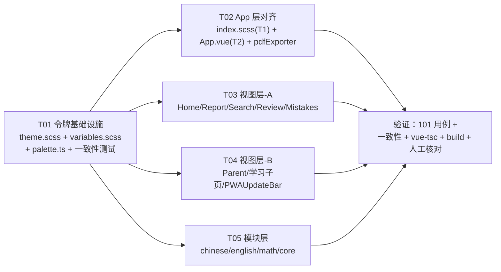

# 家庭学习系统 · UI 主题重构（增量设计 + 任务清单）

> 角色：架构师 高见远 ｜ 范围：T1 清理冲突块 / T2 对齐 themeOverrides / T3 收敛组件硬编码色值（一次交付）
> 约束：不写实现代码；不改设计（不调色相），只把值搬家到 token；不打包 exe；项目无 git，备份 `D:\study_backup_20261015` 只读。

---

## Part A · 系统设计

### 1. 实现方法（Implementation Approach）

#### 1.1 核心难点
| 难点 | 说明 | 对策 |
|---|---|---|
| **双源漂移** | 颜色有两套“真相”：CSS 侧 `theme.scss`（`var(--x)`）与 JS 侧 `naive-ui themeOverrides`。naive-ui 会对 `primaryColor` 做运算派生 hover/pressed，**不能写 `var(--x)`** | 新增 `src/core/styles/palette.ts` 作为 **JS 侧唯一数值源**；`App.vue` 从它取值；用单测锁死它与 `theme.scss` 数值一致 |
| **特异性冲突** | `index.scss` 的 `.dark-mode`（0,1,0）压过 `theme.scss` 的 `body`（0,0,1），把 `--bg-color` 顶掉并强制 `.app-header/.app-nav/.card` 变 `#1e1e1e` | T1 删除该遗留块；`body` 背景统一由 `theme.scss` 单点定义 |
| **组件硬编码** | 28 个文件、约 240 处 `#hex` + 约 104 处 `rgba(数字,…)`，多为旧 indigo/emerald/amber/red 混搭，深色下不可控 | T3 逐处映射到语义 token / 学科 token / 中性 token；`rgba(数字)` 改为 `rgba(var(--x-rgb), a)` |
| **无视觉回归测试** | 无法自动比对像素 | 以 `palette.ts ↔ theme.scss` 一致性单测兜住“双源漂移”，人工核对浅/深色 |

#### 1.2 技术选型（沿用，不引入新框架）
- **框架**：Vue 3.5 + TypeScript 5.7 + Vite 5 + Tauri（既有）。
- **UI 库**：naive-ui `^2.40.1`（`themeOverrides` 走 JS 数值）。
- **样式**：SCSS（`sass ^1.83`），经 `vite.config.ts → css.preprocessorOptions.scss.additionalData` 全局注入 `variables.scss`，故任意 `<style lang="scss">` 可直接用 `$` 变量。
- **测试**：vitest `^2.1.8`（已配 `cacheDir: node_modules/.vitest-cache` + `pool:'forks'`），测试目录 `tests/**/*.test.ts`，环境 `node`。
- **新增依赖**：**无**（不需要 `sass` API 之外的东西；一致性测试用 Node 内置 `fs` + 手写解析，避免引入 `sass` 运行时）。
- **设计模式**：**Token-First（令牌优先）+ 门面（Facade）**。`theme.scss`=唯一 CSS 源；`variables.scss`=SCSS 门面（`$x: var(--x)`）；`palette.ts`=JS 数值源。组件只认令牌，不认字面量。

#### 1.3 分层
```
theme.scss         ← CSS 变量唯一源（:root 浅 / body.dark-mode 深，成对）
   │ 被 @import
index.scss         ← 全局基底（字体、box-sizing）；不得再定义 body 背景/深色覆盖
variables.scss     ← SCSS 门面：$x = var(--x)；学科色为常量
palette.ts         ← JS 数值源（light/dark/subjects/radius/gradients）→ 仅 App.vue 使用
App.vue            ← themeOverrides 由 palette.ts 派生（naive-ui 侧）
components/*.vue   ← 只引用 $x 或 var(--x) 或 palette.ts（图表/内联）
tests/palette-consistency.test.ts ← 断言 palette.ts ⇄ theme.scss 一致
```

---

### 2. 文件清单（File List）

**新增**
```
src/core/styles/palette.ts                      # JS 侧唯一色源（naive-ui 数值）
tests/palette-consistency.test.ts               # palette.ts ↔ theme.scss 一致性单测
```

**改动**
```
src/core/styles/theme.scss                       # 新增 token：*-rgb / on-strong / band-* / code-color
src/core/styles/variables.scss                   # 门面补齐新 token 的 $ 别名
src/core/styles/index.scss                       # T1：删 17–26 行 .dark-mode 冲突块；body 去重
src/App.vue                                      # T2：themeOverrides 改由 palette 派生；<style> body 去重；308/315 去 indigo
src/core/report/pdfExporter.ts                   # #ffffff → palette.light.cardBg
# ↓ T3 视图层（12 个）
src/views/Home.vue  Report.vue  Search.vue  Review.vue  Mistakes.vue  Parent.vue
src/views/learn/TopicList.vue  PackageList.vue  UnitList.vue  ExamPanel.vue  TopicDetail.vue
src/core/pwa/PWAUpdateBar.vue
# ↓ T3 模块层（14 个）
src/modules/chinese/ChineseText.vue  ChineseWords.vue  ChineseWriting.vue  ChinesePoem.vue
src/modules/english/EnglishVocab.vue  EnglishReading.vue  EnglishSentence.vue
src/modules/english/EnglishGrammar.vue  EnglishWriting.vue
src/modules/math/MathFormula.vue
src/modules/core/QuizEngine.vue  VocabDrill.vue  UnknownModule.vue
```
> 保留不动：`theme.scss` / `variables.scss` 中 token 定义本身（它们是源）；`Settings.vue`（经核验无硬编码色值）；`fontSizeMap` 双缩放（见 §7）。

---

### 3. 数据结构与接口（Class Diagram）

见 `docs/class-diagram.mermaid`。要点：

- `ThemePalette`（接口）：`light` / `dark` 两套 `ThemeColors`，字段与 `theme.scss` 变量一一对应（camelCase ↔ kebab-case）。
- `palette`（常量对象）：`{ light, dark, subjects, radius, gradients }`，是 `App.vue` 唯一取值处。
- `ThemeScssParser`（测试工具）：`parse(text) → { light: Record<string,string>, dark: Record<string,string> }`；`normalizeColor(v) → string`。
- `buildThemeOverrides(palette, theme, sizes) → NaiveThemeOverrides`：由 `App.vue` 内联逻辑抽成纯函数（便于单测）。
- `useThemeStore`（既有）：产出 `actualTheme` / `fontSize`，驱动 `body.dark-mode` 与 naive-ui `theme`。

关键映射（palette 字段 ← theme.scss 变量）：
| palette 字段 | theme.scss 变量 | light | dark |
|---|---|---|---|
| `primary` | `--primary-color` | `#2d6a4f` | `#4fa57f` |
| `primaryHover` | `--primary-hover` | `#245741` | `#5fb88f` |
| `primaryPressed` | `--primary-pressed` | `#1c4633` | `#3f8a69` |
| `textMain` | `--text-main` | `#16261f` | `#e8f1ec` |
| `textSub` | `--text-sub` | `#3f574c` | `#b6c8bf` |
| `textMuted` | `--text-muted` | `#5f756a` | `#8b9c93` |
| `cardBg` | `--card-bg` | `#ffffff` | `#15211c` |
| `border` | `--border-color` | `#cfdcd5` | `#2a3b34` |
| `success` / `warning` / `danger` / `info` | `--*-color` | `#15803d`/`#b45309`/`#dc2626`/`#2563eb` | `#4ade80`/`#fbbf24`/`#f87171`/`#60a5fa` |
| `subjects.*` | `variables.scss` 常量 | （不随主题） | （同 light） |

---

### 4. 程序调用流（Sequence Diagram）

见 `docs/sequence-diagram.mermaid`。两条主链路：

**A. 主题渲染链路**
`useThemeStore.actualTheme` → `watchEffect` 挂 `body.dark-mode` → CSS 变量随选择器切换 → 组件 `var(--x)` 自动刷新；同时 `App.vue` 的 `buildThemeOverrides(palette, actualTheme, sizes)` 重算 → 传给 `<n-config-provider :theme-overrides>` → naive-ui 组件重绘。

**B. 一致性测试链路**
vitest 启动 → 读 `theme.scss` 文本 → `ThemeScssParser.parse` 切出 `light`/`dark` 两张变量表 → `normalizeColor` 归一化 → 对 `palette` 的每个共享字段断言 `normalize(palette)=normalize(theme)`；学科色额外读 `variables.scss` 常量断言。

---

### 5. 待明确 / 歧义（Anything UNCLEAR）

1. **token 新增许可**：本设计**允许新增 token**（见 §8 白名单），但严格限定「不改色相」——新增 token 的 light 值 = 现有硬编码字面量的**精确搬运**（仅中性近白可能收敛到最近 token，见 §8.6）。
2. **中性近白收敛尺度**：`#f7f9fc / #fafbfc / #f4f6f8 / #f0f4f8 / #eef2f7 / #f9f6f0` 拟统一映射到 `$surface-2 / $bg-color-hover`，存在 ≤3% 亮度差（肉眼不可辨）。若要求**像素级不变**，需为每个中性色各建 token——**默认按收敛处理**。
3. **语义强调色统一**：emerald `#10b981` → `success`(`#15803d`)、amber `#f59e0b` → `warning`(`#b45309`) 等属**同色系内收敛**（非跨色相），默认执行。若认为绿/橙的明度变化属“改视觉”，需改为保留原值的独立 token。
4. **`fontSizeMap` 双缩放**：`App.vue:149-159` 的 `fontSizeMap`（naive-ui 字号）与 `theme.ts:20-21` 的 `documentElement.style.fontSize`（根字号，rem 缩放）**同时生效**，存在双重放大的隐患。**本次不处理，仅记录**（超出主题色范围）。
5. **`#c7254e` 归属**：既用于 English 模块 `:deep(code)`，也用于非学科页 `TopicDetail`，故**不并入学科色**，而是新建通用 `--code-color`。
6. **深色值来源**：新增 token（`--code-color`、`--band-*`、`--x-rgb` 等）深色取值由本设计给出建议值（§8.2），因“深色可变”故不构成阻塞，允许工程师微调但需评审。
7. **【已裁决】`--shadow-up`（方向性阴影）**：底部固定栏（`.app-nav`，原值 `0 -4px 16px rgba(0,0,0,0.06)`；及 `QuizEngine` 的 `.quiz-actions`）需要**上向**投影，而既有 `$shadow-*` 全为**下向**、无法表达；同时 §8.9 禁止组件内写 `rgba(数字)` 字面量。因此「浅色逐字节不变 + 组件零硬编码」**只能靠新增方向性 token 才能同时满足**，`--shadow-up` 为最小正确解。**裁决**：正式纳入 §8.5 白名单**第 5 类（阴影类）**，`theme.scss` 浅 `0 -4px 16px rgba(0, 0, 0, 0.06)`（精确原值）/ 深 `0 -4px 16px rgba(0, 0, 0, 0.30)`，`variables.scss` 门面 `$shadow-up`。**QA 第 2 轮已复核通过**（底栏阴影逐字节还原）。

---

## Part B · 任务分解

### 6. 依赖包（Required Packages）

无新增。复用现有：
```
- vue@^3.5.13            : 框架
- naive-ui@^2.40.1       : UI 库（themeOverrides 数值源）
- sass@^1.83.0           : SCSS 编译
- typescript@^5.7.2      : 类型
- vitest@^2.1.8          : 单测（一致性测试）
- (Node 内置 fs/path)    : 测试解析 theme.scss，无第三方解析器
```

### 7. 任务清单（按依赖排序，≤5 个）

| ID | 任务名 | 源文件 | 依赖 | 优先级 |
|---|---|---|---|---|
| **T01** | **令牌基础设施**：补齐 `theme.scss`/`variables.scss` 新 token、新建 `palette.ts`、写一致性单测 | `src/core/styles/theme.scss`、`src/core/styles/variables.scss`、`src/core/styles/palette.ts`(新)、`tests/palette-consistency.test.ts`(新) | — | P0 |
| **T02** | **App 层对齐（T1+T2）**：删 `index.scss` 冲突块、`themeOverrides` 改由 `palette` 派生、App `<style>` body 去重、去 308/315 indigo、`pdfExporter` 取 palette | `src/core/styles/index.scss`、`src/App.vue`、`src/core/report/pdfExporter.ts` | T01 | P0 |
| **T03** | **视图层收敛-A**：首页/报告/搜索/复习/错题 | `src/views/Home.vue`、`Report.vue`、`Search.vue`、`Review.vue`、`Mistakes.vue` | T01 | P1 |
| **T04** | **视图层收敛-B**：家长/学习子页/更新条 | `src/views/Parent.vue`、`learn/TopicList.vue`、`learn/PackageList.vue`、`learn/UnitList.vue`、`learn/ExamPanel.vue`、`learn/TopicDetail.vue`、`core/pwa/PWAUpdateBar.vue` | T01 | P1 |
| **T05** | **模块层收敛**：语文/英语/数学/核心练习 | `modules/chinese/*.vue`(4)、`modules/english/*.vue`(5)、`modules/math/MathFormula.vue`、`modules/core/QuizEngine.vue`、`VocabDrill.vue`、`UnknownModule.vue` | T01 | P1 |

> 说明：T03/T04/T05 **仅依赖 T01**（各自独立、可并行），避免线性依赖链。验证（101 用例回归 + 一致性测试 + `vue-tsc` + build + 人工核对）由团队验证任务承接，本清单不单列，但其**准入条件**见 §8.8。

**为什么 T1/T2 耦合**：`index.scss` 的 `.dark-mode` 块把 `body` 背景写成 `#121212`、把 `.app-header/.app-nav/.card` 写成 `#1e1e1e`（特异性压过 theme.scss 的 `--bg-color`/`--card-bg`）。而 `.card` 真实挂在 `n-card` 上（Report/Review/Search/Settings）。**只要该块不删，T2 把 `themeOverrides` 改成松绿也无用**——深色的标题栏/卡片仍被 `#1e1e1e` 顶掉；反过来只删块不改 `themeOverrides`，naive-ui 组件仍是旧 indigo。二者共同决定深色观感，必须同批交付，故合并为 T02。T02 同时依赖 T01 的 `palette.ts`。

---

### 8. 共享知识（跨文件约定）

#### 8.1 语义强调色 → 家族 token（**同色系内收敛**）
| 硬编码 | 目标令牌 | 备注 |
|---|---|---|
| `#6366f1` `#8b5cf6` `#a56cf0` `#a5b4fc` `#4f46e5` `#4338ca` | `$primary-color` / `$primary-hover` / `$primary-light`（→ `var(--primary-*)`） | **决策③**：旧 indigo/violet 全部并入主色松绿，此后无独立 accent |
| `#10b981` `#059669` `#18a058` `#0ea5a0` | `$success-color` | 绿系统一 |
| `#e8fff0` `#e9…` | `$success-light` | |
| `#ef4444` `#dc2626` `#e74c3c` `#d03050` `#c0392b` `#991b1b` | `$danger-color` | `#991b1b`（深红）建议下沉为 `--danger-strong` |
| `#f59e0b` `#f39c12` `#f0a020` `#f0c020` `#d97706` `#ff9500` | `$warning-color` | |
| `#fff3b0` `#7a5c00`（搜索高亮） | `$warning-light` / `$warning-color` | |
| `#1677ff` `#2080f0` `#06b6d4` | `$info-color` | |
| `#e8f4ff` `#eef2f7` | `$info-light` / `$surface-2` | |

#### 8.2 `rgba(数字,…)` 收敛规则（**选型：`--x-rgb` 三元组**）
- **首选**：`rgba(16,185,129,0.12)` → `rgba(var(--success-rgb), 0.12)`。theme.scss 新增 `--primary-rgb/--success-rgb/--warning-rgb/--danger-rgb/--info-rgb`（浅深各一套，如 `--success-rgb: 21, 128, 61` / 深 `74, 222, 128`）。
- **理由**：① 保留调用点对 alpha 的细粒度控制（现网有 .04/.06/.08/.1/.12/.14/.15/.2 多档，`--x-soft` 只有固定 0.10，不够用）；② 随主题自适应；③ `rgba(var(--x),a)` 兼容所有 WebView，**优过 `color-mix()`**（Tauri 依赖的 WebView2/WebKitGTK 版本不确定，`color-mix` 需较新内核）。
- `--x-soft`（固定 10%）与 `--x-soft-strong`（18%）保留，供“标准淡底”直接引用；非标准 alpha 一律走 `-rgb`。
- 白色透明叠层（`rgba(255,255,255,.06/.08/.1/.12/.18/.28/.65/.92)`，用于渐变头图/深色卡上的分隔与玻璃感）→ `rgba(var(--on-strong-rgb), a)`，`--on-strong-rgb: 255, 255, 255`（浅深同值）。
- 黑色阴影/虚线（`rgba(0,0,0,a)`）→ 既有 `$shadow-*`（**仅下向**阴影）/ `$border-color`（虚线边框）；**方向性（上向）阴影**（固定底栏 `.app-nav`、`QuizEngine .quiz-actions`）→ 新增 `--shadow-up`（见 §8.5 第 5 类）。

#### 8.3 `#fff` / `#ffffff` “按用途判断”规则
| 用途 | 判定 | 目标 |
|---|---|---|
| 作 **背景**（`background`/`background-color`） | 是容器底色 | `$card-bg`（深色自动变深） |
| 作 **前景/图标色**（`color`）覆盖在**饱和色块**上（badge `#ef4444`/`#10b981`、渐变头图、主色按钮） | 是“色块上的字” | `$on-strong`（= `var(--on-strong)`，浅深**恒为 `#ffffff`**） |
| 作 **半透明叠层** | 见 8.2 | `rgba(var(--on-strong-rgb), a)` |
| PDF/画布导出（JS 需真值） | `pdfExporter.ts` | `palette.light.cardBg` |
- 说明：`--on-strong` 是**唯一“主题无关”语义色**，故只在 `:root` 定义一次（深色无需覆盖），但需在注释中标注“恒白”。

#### 8.4 学科色保留策略（**主题无关，不新增深色变体**）
- `#8a6b4a→$subject-chinese`、`#5b4226→$subject-chinese-deep`、`#b7791f→$subject-chinese-accent`、`#d4b87a→$subject-chinese-soft`；`#1a5490→$subject-english`、`#4a90d9→$subject-english-light`。
- 上述 6 个常量**已在 `variables.scss` 定义**，组件只需把字面量替换为 `$subject-*` 即可（零风险、零视觉变化）。
- `#c7254e`（英文 code / TopicDetail code）→ **新建 `--code-color`**（浅 `#c7254e`，深建议 `#f08aa8`），不用学科色。

#### 8.5 新增 token 白名单（**仅此五类，其余不得新增**）
1. `--{primary|success|warning|danger|info}-rgb`（10 个：浅深各 5）——供 8.2。
2. `--on-strong`、`--on-strong-rgb`（主题无关，仅 `:root`）——供 8.3。
3. `--band-success-bg|border`、`--band-warning-bg|border`、`--band-danger-bg|border`（浅深各 6）——Report 分数档位，**light 值精确搬运**：`#effcf4`/`#c8f0d8`、`#fff9ec`/`#ffe4b0`、`#fff0f0`/`#ffd4d4`。
4. `--code-color`（浅深各 1）——供 8.4。
5. `--shadow-up`（浅深各 1）——**方向性（上向）阴影**。引入原因：既有 `$shadow-*` **全为下向**，无法表达固定底栏 `.app-nav` / `QuizEngine .quiz-actions` 的**上向**投影（原值 `0 -4px 16px rgba(0,0,0,0.06)`）；且 §8.9 禁止组件内写 `rgba(数字)` 字面量，二者叠加导致「浅色逐字节不变 + 组件零硬编码」**必须靠方向性 token 才能同时满足**。浅 `0 -4px 16px rgba(0, 0, 0, 0.06)`（精确搬运原值）/ 深 `0 -4px 16px rgba(0, 0, 0, 0.30)`；门面 `$shadow-up`。
> 每个新增 token 必须**同时**在 `:root` 与 `body.dark-mode` 出现（`--on-strong*` 除外），并同步到 `variables.scss` 门面（`$on-strong`、`$band-*`、`$code-color`、`$shadow-up`）。

#### 8.6 渐变处理
- `theme.scss` 的 `--gradient-*` 是唯一渐变源；组件**优先整体引用** `$gradient-primary/warm/cool/success/sunset`。
- 旧 indigo 渐变 `linear-gradient(135deg,#6366f1,#8b5cf6)`（Home:653、Parent:376/484、TopicDetail:639）→ `$gradient-primary`。
- 绿青渐变 `linear-gradient(90deg,#10b981,#06b6d4)` → `$gradient-success`；红黄渐变 `linear-gradient(90deg,#ef4444,#f59e0b)` / `.active` 进度条 → `$gradient-warm`。
- 关闭/开启状态的小渐变（如 CSS 动画里的 `rgba(99,102,241,.4→0)` 脉冲）→ `rgba(var(--primary-rgb), .4→0)`。
- **纯色进度条**（`background:#e74c3c`）按 8.1 映射语义色即可，不必强造渐变 token。

#### 8.7 内联 `style="..."` vs `<style>` 块
| 场景 | 处理 |
|---|---|
| 模板内联 `style="background:#6366f1"`（仅 `Home.vue:151/158/165` 三处 stat-dot） | 内联 style **无法用 SCSS `$var`**，直接用 CSS 变量：`style="background: var(--primary-color)"` 等 |
| JS 运行时取色（echarts `itemStyle.color`、`isDark ? … : …`，见 `Home.vue:350-363`、`QuizEngine`、`pdfExporter`） | 必须真值 → 从 `palette.ts` 取：`palette[theme].cardBg` / `.primary` … |
| `<style lang="scss">` 块内 | 一律 SCSS 变量 `$x`（即 `var(--x)`） |

#### 8.8 `!important` 与验证准入
- **`!important` 清理策略**：全库仅 1 处（`QuizEngine.vue:801` 的 `gap:0 !important`），属布局非颜色，**本次不动**（保持最小改动面）。
- **验证准入（T02–T05 每批完成后自检）**：`npx vue-tsc --noEmit` 零错误 → `npm test`（101 用例 + 新增一致性测试全绿）→ `npm run build` 通过 → 目测浅/深色下导航激活态、卡片底色、badge、进度条无旧 indigo/`#1e1e1e` 残留（沙箱下 npm 需提权）。

#### 8.9 全局不变量
- API/数据格式无关；**颜色格式约定**：CSS 侧 `theme.scss` 一律小写 hex 或 `rgba(r, g, b, a)`（逗号后带空格）；JS 侧 `palette.ts` 一律小写 hex，供 naive-ui。
- 组件内**禁止**再出现 `#hex` / `rgba(数字,…)`；唯三例外：`variables.scss`（学科常量）、`theme.scss`（token 定义）、8.5 白名单外不得新增。
- **方向性阴影**：上向阴影（`0 -Npx …`，如固定底栏 `.app-nav` / `.quiz-actions`）一律走 `--shadow-up`（见 §8.5 第 5 类）；下向阴影走既有 `$shadow-*`。禁止在组件内写 `rgba(数字)` 阴影字面量。

---

### 9. 任务依赖图

见下方 Mermaid（同时写入 `docs/system_design.md`）：



---

## 附录 · 一致性测试设计（落地要点）

> 目标：锁死 `palette.ts`（JS 源）与 `theme.scss`（CSS 源）不漂移。

1. **读取**：`fs.readFileSync(resolve(process.cwd(), 'src/core/styles/theme.scss'), 'utf8')`；`variables.scss` 同理。
2. **切分主题**：定位首个 `body.dark-mode {` 的下标；**之前**段落 = 浅色上下文，**之后** = 深色上下文（浅色变量都在 `:root` 且在深色之前，结构稳定）。
3. **抽变量**：在每段内用 `/(--[\w-]+)\s*:\s*([^;]+);/g` 收集 `name → rawValue`（浅色段含两个 `:root`——尺寸块与颜色块，直接合并；深色段含变量块与组件微调块，微调块无 `--x:` 定义，天然不影响）。
4. **归一化**（`normalizeColor`）：
   - hex：`toLowerCase()`、`#abc → #aabbcc`、`trim()`；
   - `rgba()/rgb()`：去括号内所有空白 → 解析 `r,g,b,a` → 重组为 `rgba(r, g, b, a)`（alpha 去尾零：`0.10→0.1`）；
   - 渐变/阴影字符串：去掉全部空白后比较（或按 `,` 分片归一化）；
   - `var(--x)` 引用层：`palette.ts` 存**最终数值**，`theme.scss` 该字段也是数值（非 `var`），故直接比数值即可；若某字段在 `theme.scss` 里是 `var(--y)`（如 `variables.scss` 门面），则跳过（门面不参与数值断言）。
5. **断言**：对 `palette.light`/`palette.dark` 中每个与 `theme.scss` 共享的字段，`expect(normalize(paletteVal)).toBe(normalize(scssVal))`；学科色对 `variables.scss` 常量断言；`radius` 对 `theme.scss` 的 `--radius-*` 断言。
6. **失败信息**：断言体附带字段名与两值，便于定位漂移源。

---

*本文件由架构师高见远产出，仅含设计与任务清单，不含实现代码。*
